# **BLE Current Consumption Measurement**

## Table of Contents
<!-- TOC -->

- [Introduction](#1-introduction)
- [Prerequisites](#2-prerequisites)
  - [Hardware Requirements](#21-hardware-requirements)
  - [Software Requirements](#22-software-requirements)
- [Setup Diagram](#3-setup-diagram)
- [Project Creation](#4-project-creation)
  - [SiWx917 Project](#41-siwx917-project)
  - [SiWx917 SoC Project](#42-siwx917-SoC-project)
  - [SiWx917 NCP Project](#43-siwx917-NCP-project)
- [Application Configuration](#5-application-configuration)
- [Testing the Application](#6-testing-the-application)
  - [Build the Application](#61-build-the-application)
  - [Application execution](#62-application-execution)
  - [Energy Profiler settings](#63-Energy-Profiler-settings)
  - [Advertising Current consumption measurement](#64-advertising-current-consumption-measurement)
    - [Advertising, Unconnectable](#641-advertising,-unconnectable)
    - [Advertising, Connectable](#642-advertising,-connectable)
  - [Connection Current consumption measurement](#65-connection-current-consumption-measurement)
    - [Connection Interval at 1.28sec](#651-connection-interval-at-1.28sec)
    - [Connection Interval at 200msec](#652-connection-interval-at-200msec)
- [Appendix](#appendix)
  - [SoC Ram retension 192kB configuration](#soc-ram-retension-192kB-configuration)
  - [EFR32xG21 Central Configuration & Connection](#efr32xg21-central-configuration-&-connection)

<!-- /TOC -->

## **1. Introduction**

This application demonstrates the procedure to get the BLE connected states current consumption numbers meantioned in the datasheet.

## **2. Prerequisites**

The user must configure the following items before launching the application.

### 2.1 Hardware Requirements
- EFR32XG21 device as a remote device
- Windows PC
- Power Analyzer
#### **2.1.1 SoC** 

   - Silicon Labs SiWx917 PK6031A SoC Kit which includes
      - BRD4002A Wireless Starter Kit Mainboard
      - BRD4338A Radio Board
   
#### **2.1.2 NCP**

   - Silicon Labs BRD4346A radio board 
   - [Silicon Labs SLWSTK6006A EFR32xG21 Wireless Starter Kit](https://www.silabs.com/development-tools/wireless/efr32xg21-wireless-starter-kit) which includes
      - BRD4002A Wireless Starter Kit Mainboard
      - BRD4180A/BRD4180B Radio Board


### 2.2 Software Requirements

- SiWx917_WiSeConnect_SDK [link](https://github.com/SiliconLabs/wiseconnect)
- Simplicity Studio IDE
  - To download and install the Simplicity Studio IDE, refer to the [Simplicity Studio IDE Set up](https://docs.silabs.com/) section in ***Getting started with SiWx91x*** guides.
- Simplicity Connect application for [Android](https://play.google.com/store/apps/details?id=com.siliconlabs.bledemo&hl=en&gl=US) or [iOS](https://apps.apple.com/in/app/simplicity-connect/id1030932759)
- Docklight or Tera Term or a similar tool for reading serial prints

**Note:**
The application can be evaluated from the 3.5.1 SDK & Firmware. But it is recommended to use the latest SDK & Firmware available on the website.

## **3. Setup Diagram**
- This section describes the setup diagram of the BLE current consumption numbers measurement.
   <br>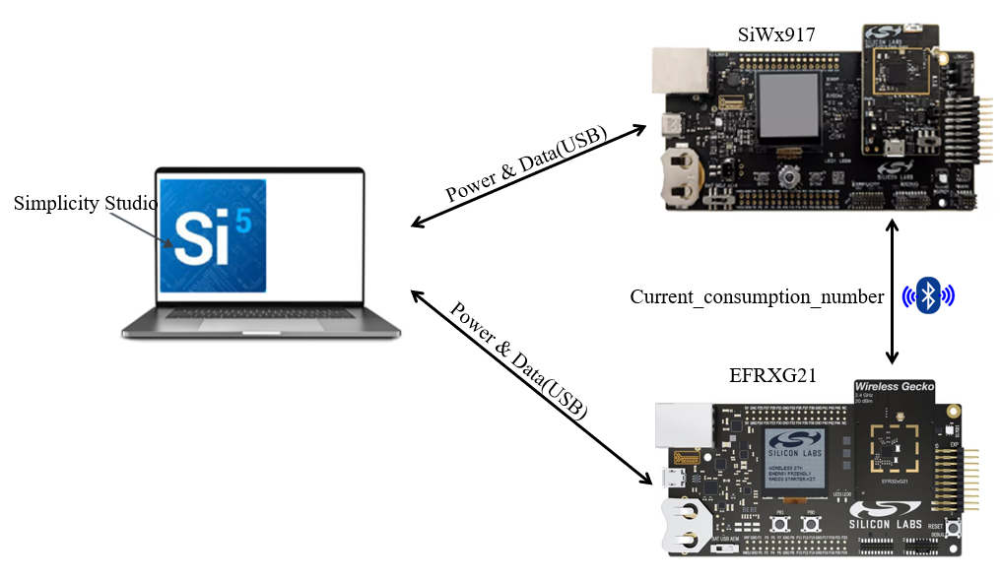<br>

- Follow the "Hardware connections and Simplicity Studio IDE Set up" section in the respective [Getting Started with SiWx91x](https://docs.silabs.com/wiseconnect/3.0.9/wiseconnect-getting-started/getting-started-with-soc-mode) guides to make the hardware connections and add the Gecko and SiWx91x WiFi SDK to the Simplicity Studio IDE.

- Ensure the SiWx91x module is loaded with the latest firmware following the [SiWx91x Firmware Update](https://docs.silabs.com/rs9116/latest/wiseconnect-getting-started) section in the respective Getting started with SiWx91x*** guides. Please note that the current project was tested on SiWx917_WiSeConnect_SDK.3.4.0(SiWG917-B.2.13.3.0.0.11.rps).

- To configure the EFR32XG21 device as a NCP device, please follow the steps mentioned in the [BT NCP](https://github.com/SiliconLabs/simplicity_sdk/tree/sisdk-2024.12/app/bluetooth/example/bt_ncp) readme file and use the **Discover - Central** tab for configuring the EFR32XG21 as a central device.

## **4. Project Creation**

### 4.1 SiWx917 Project

- Refer to the instructions [here](https://docs.silabs.com/wiseconnect/latest/wiseconnect-getting-started/) to:

  - Install Studio and WiSeConnect 3 extension
  - Connect your device to the computer
  - Upgrade your connectivity firmware
  - Create a Studio project

- Download the project **iot-pa-ble_per_active_current_measurement** from the GitHub [link](https://github.com/SiliconLabs/wifi_combo_applications/tree/master/SiWx917)
- Keep the project in the Release folder at location: `SDK/examples/snippets/ble/`
- Open **templates.xml** file located at `SDK/templates.xml` and add the code snippet at the end, before `</model:MDescriptors>`:

```sh
<descriptors name="ble_current_consumption_measurement_soc" label="BLE - Current Consumption Measurement(SoC)" description="This application demonstrates the procedure to get the BLE connected states current consumption numbers meantioned in the datasheet">
    <properties key="namespace" value="template.uc"/>
    <properties key="keywords" value="universal\ configurator"/>
    <properties key="projectFilePaths" value="examples/snippets/ble/iot-pa-ble-current_consumption_measurement/ble_current_consumption_measurement_soc.slcp"/>
    <properties key="boardCompatibility" value="com.silabs.board.none brd2605a brd4338a brd4342a brd4340a brd4343a brd4343b brd4339b brd4340b brd4341a brd4343q brd2708a brd2911a brd4344a brd4344b"/>
    <properties key="partCompatibility" value=" .*si917.* .*siwg917m111mgtba.* .*siwg917m141xgtba.* .*siwg917y111mgab.* .*siwg917y111mgnba.* .*siwg917y121mgnb.* .*siwg917m121xgtba.* .*siwg917m111xgtba.* .*siwg917m100mgtba.* .*siwg917m100xntba.* .*siwg917m110lgtba.* .*siwg917y110lgnba.* .*siwg915m000mgtba.* .*siwg915m000lgtba.*"/>
    <properties key="ideCompatibility" value="makefile-ide simplicity-ide visual-studio-code generic-template"/>
    <properties key="toolchainCompatibility" value="gcc"/>
    <properties key="quality" value="production"/>
    <properties key="category" value="Example|Wi-Fi"/>
    <properties key="stockConfigCompatibility" value="com.silabs.ss.framework.project.toolchain.core.default"/>
    <properties key="sdkAndProtocolTags" value=""/>
    <properties key="readmeFiles" value="examples/snippets/ble/iot-pa-ble-current_consumption_measurement/readme.md"/>
	<properties key="filters" value="Device\ Type|SoC Wireless\ Technology|Bluetooth Project\ Difficulty|Beginner"/>
  </descriptors>
<descriptors name="ble_current_consumption_measurement_ncp" label="BLE - Current Consumption Measurement(NCP)" description="This application demonstrates the procedure to get the BLE connected states current consumption numbers meantioned in the datasheet">
    <properties key="namespace" value="template.uc"/>
    <properties key="keywords" value="universal\ configurator"/>
    <properties key="projectFilePaths" value="examples/snippets/ble/iot-pa-ble-current_consumption_measurement/ble_current_consumption_measurement_ncp.slcp"/>
    <properties key="boardCompatibility" value="com.silabs.board.none brd4180a brd4180b brd4186c"/>
    <properties key="partCompatibility" value=" mcu.arm.efr32.mg21.* mcu.arm.efr32.mg21.* mcu.arm.efr32.mg24.* mcu.arm.efr32.fg25.*"/>
    <properties key="ideCompatibility" value="makefile-ide simplicity-ide visual-studio-code generic-template"/>
    <properties key="toolchainCompatibility" value="gcc"/>
    <properties key="quality" value="production"/>
    <properties key="category" value="Example|Wi-Fi"/>
    <properties key="stockConfigCompatibility" value="com.silabs.ss.framework.project.toolchain.core.default"/>
    <properties key="sdkAndProtocolTags" value=""/>
    <properties key="readmeFiles" value="examples/snippets/ble/iot-pa-ble-current_consumption_measurement/readme.md"/>
	<properties key="filters" value="Device\ Type|NCP Wireless\ Technology|Bluetooth Project\ Difficulty|Beginner"/>
  </descriptors>
```

- Refresh the Gecko SDK.
<br>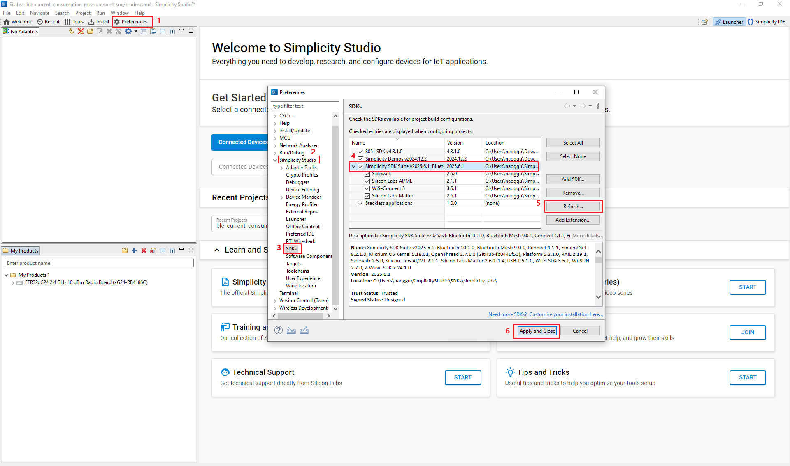<br>

### 4.2 SiWx917 SoC Project

- Connect the SiWx917 SoC kit and create the project.
<br>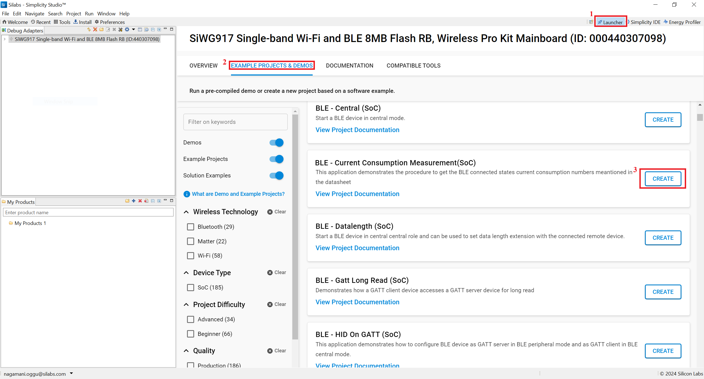<br>

### 4.3 SiWx917 NCP Project
- Connect the SiWx917 NCP kit and create the project.
<br>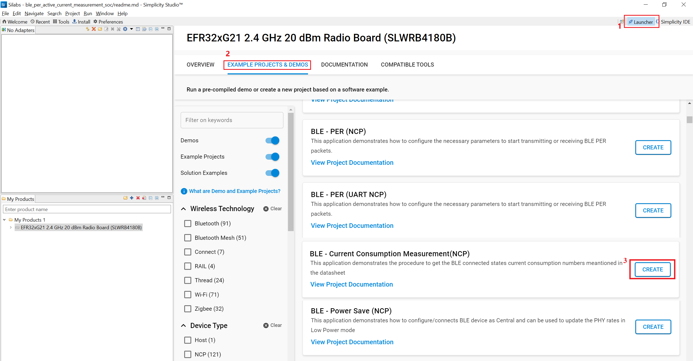<br>

## **5. Application Configuration**

The application can be configured to suit you requirements and development environment. Go through the following sections and make any changes if needed.

- In the Project explorer pane of the IDE, expand the **ble\_current\_consumption\_measurement** folder and open the **ble\_config.h** file. 
   ```c
   //! BLE_ROLE Refer to the SiWx91x module Role either "ADVERTISING_ROLE" or "CONNECTION_ROLE".
      //! ADVERTISING_ROLE used to verify the datasheet advertising numbers
      //! CONNECTION_ROLE used to verify the datasheet connection numbers
   #define BLE_ROLE        ADVERTISING_ROLE

   //! RSI_BLE_LOCAL_NAME Refer SiWx91x module Local name.
   #define RSI_BLE_LOCAL_NAME "SILABS_DEVICE"

   //! Advertising configuration parameters:

   //! RSI_BLE_ADV_INT_MIN refers to Minimum advertising interval (Range: 0x0020 to 0x4000 => Time = N * 0.625 msec)
   #define RSI_BLE_ADV_INT_MIN    0x0800  // 0x800 = 2048 => 2048*0.625msec => 1.28sec

   //! RSI_BLE_ADV_INT_MAX refers to Maximum advertising interval (Range: 0x0020 to 0x4000 => Time = N * 0.625 msec)
   #define RSI_BLE_ADV_INT_MAX    0x0800  // 2048*0.625msec => 1.28sec
   
   //!RSI_BLE_ADV_TYPE refer to the type of the BLE advertisiement
      //!UNDIR_NON_CONN indicates the undirected Non-connectable advertisement type
      //!UNDIR_CONN indicates the undirected connectable advertisement type
   #define RSI_BLE_ADV_TYPE          UNDIR_NON_CONN
 
   //! Connection configuration parameters:
   
   //! CONNECTION_INTERVAL_MIN refers to Minimum Connection interval (Range : 0x0006 to 0x0C80 => Time = N * 1.25 msec )
   #define CONNECTION_INTERVAL_MIN 0x0400 //0x0400 = 1024 => 1024 * 1.25msec => 1.28sec
   
   //! CONNECTION_INTERVAL_MAX refers to Maximum Connection interval(Range : 0x0006 to 0x0C80 => Time = N * 1.25 msec )
   #define CONNECTION_INTERVAL_MAX 0x0400 //1024 * 1.25msec => 1.28sec
   
   //!CONNECTION_LATENCY refers to Peripheral latency (Range : 0x0000 to 0x0C80 => Time = N * 10msec)
   #define CONNECTION_LATENCY  0x0000
   
   //!SUPERVISION_TIMEOUT refers to the timeout for the LE Link (Range : 0x000A to 0x0C80 => Time = N * 10msec)
   #define SUPERVISION_TIMEOUT 0x07D0 //0x07D0 = 2000 => 2000 * 10msec => 20sec
   ```
   <br>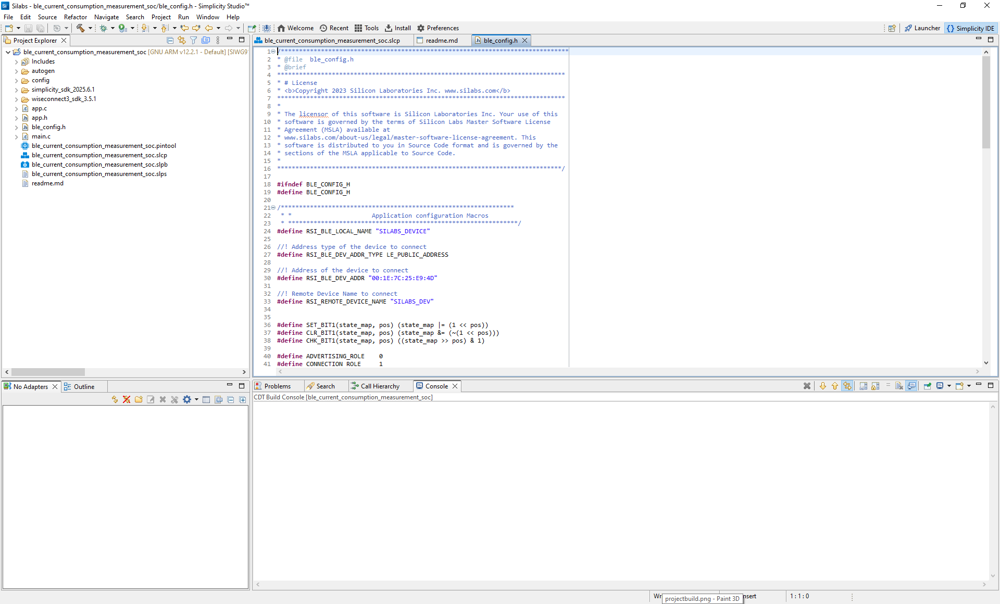<br>

- For NCP, the 352k memory configuration is required. Navigate to the "wiseconnectxx\components\device\silabs\si91x\wireless\inc" path and open the **sl\_wifi\_device.h** file. Update the "MEMORY_CONFIG" as shown below:

   ```c
      #define MEMORY_CONFIG SL_SI91X_EXT_FEAT_352K
   ```
   <br>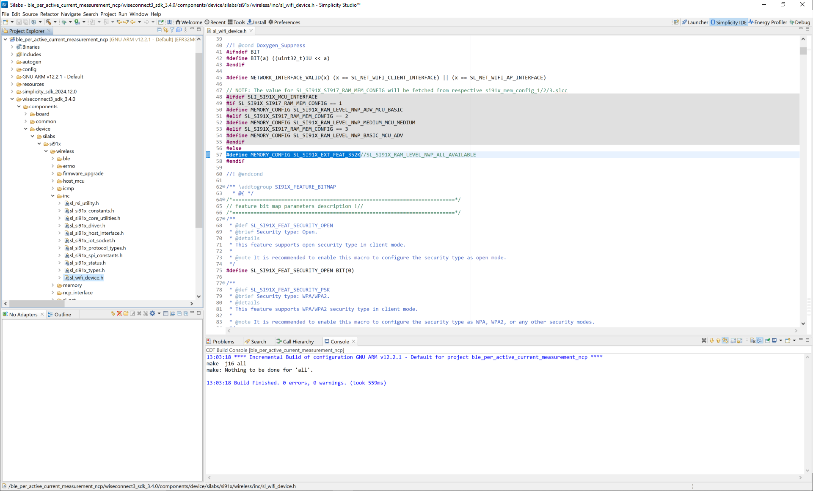<br>

In the Project explorer pane of the IDE, expand the **ble\_current\_consumption\_measurement** folder and open the **ble\_config.h** file.
## **6. Testing the Application**

This section outlines the application's step-by-step execution process.

### **6.1 Build the Application**

- After creating the project, either right-click on it and choose "Build Project" or click the build icon (a hammer) to begin building the project.
   <br>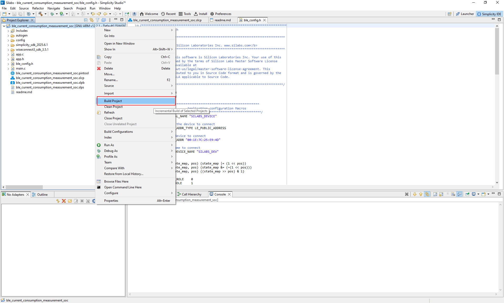<br>


## **6.2 Application execution**

After the program gets executed, the SiWx917 device is configured as a peripheral and advertisies as the "Current_consumption_number".

**Note:**

- The NCP board power measurement was evaluated using the "Current Measurement Using BRD4346A Radio Board" process. For more information, refer to the "Current Measurement Using BRD4346A Radio Board" section in the "an1433 siwx917 ncp low power application note".

-  A 10% variance in current consumption is acceptable.

## **6.3 Energy Profiler settings**
1. For monitoring power consumption, navigate to "Tools" and select "Energy Profiler" as shown below.
   <br>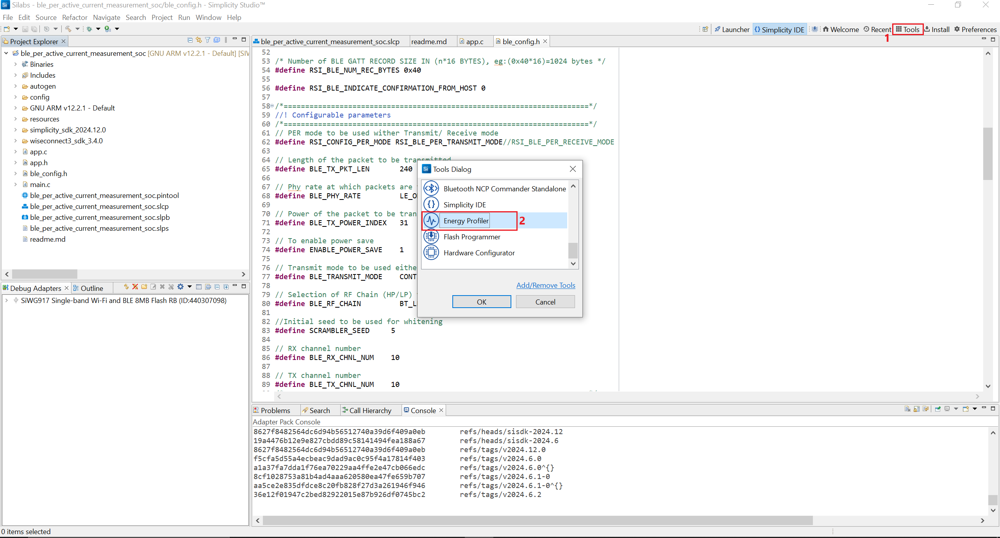<br>
2. Click on "Quick Access" and then "Start Energy Capture" to begin capturing power consumption data.
   <br>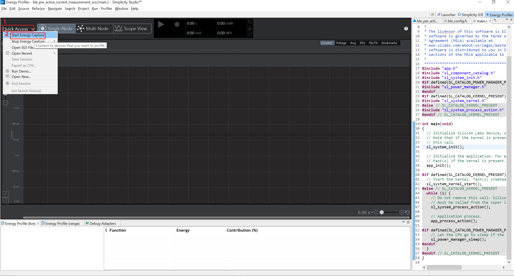<br>
3. The device selection pop-up will appear as shown below. Please select the device and click "OK".
   <br>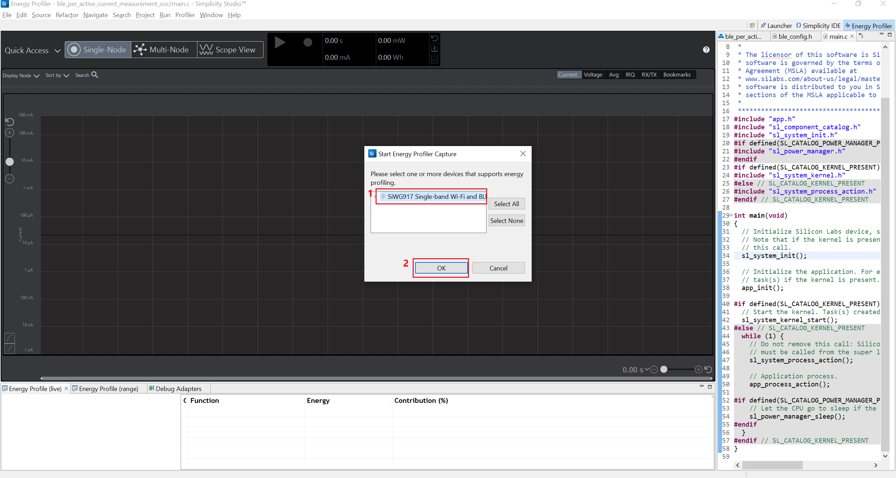<br>

## **6.4 Advertising Current consumption measurement**
To measure the Advertising cases current consumption measurement, The `BLE_ROLE` role should be configured as the `ADVERTISING_ROLE`.

## **6.4.1 Advertising, Unconnectable**

1. Configure the `RSI_BLE_ADV_TYPE` macro as `UNDIR_NON_CONN`, the SiWx917 module advertisies for every 1.28sec and connection would not be accepted from any device.

2.  Build, Flash, run, and debug the application.
   Note: Since the SiWG917 M4 is in power save mode, please ensure that the SiWG917 device remains in ISP mode to flash the application.

3. Open the energy profiler to measure the current conusmption numbers.

4. **SoC current Consumption:**
   - As shown in the below image, the observed current consumption is 36.73uA. According to the SoC data sheet, the  expected current consumption for Advertising, Unconnectable in the LP chain at 0dBm is 37uA.
   <br>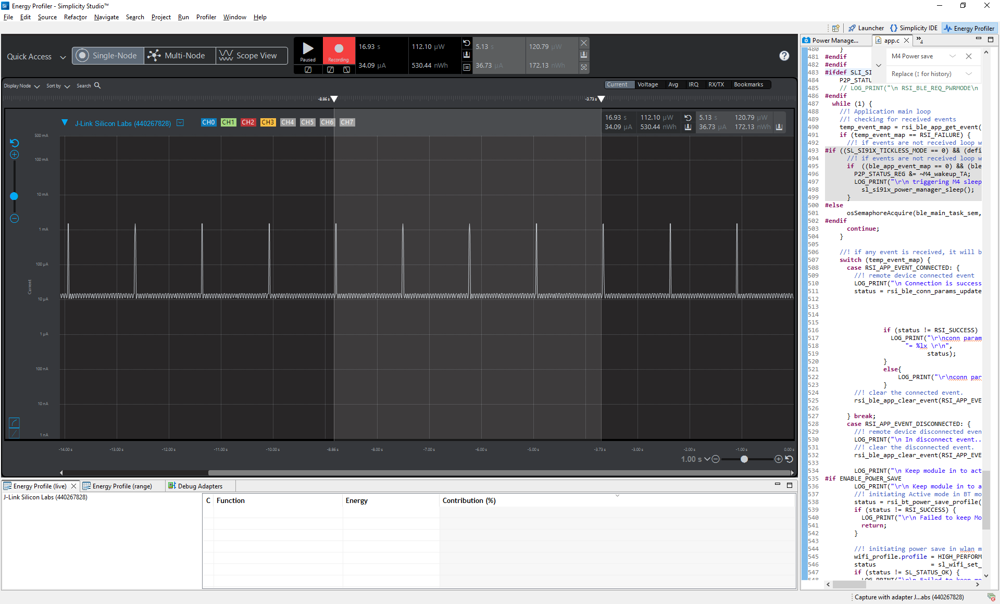<br>

5. **NCP current Consumption:**
   - As shown in the below image, the observed current consumption is 35.2uA. According to the NCP data sheet, the  expected current consumption for Advertising, Unconnectable in the LP chain at 0dBm is 37uA.
   <br>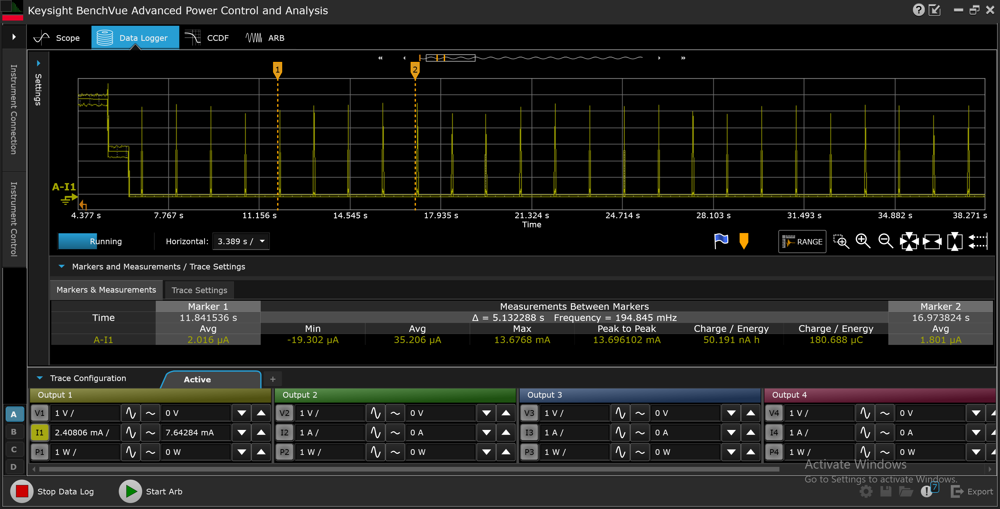<br>

6. The serial prints can see as below in any Console terminal:
   <br><br>

## **6.4.2 Advertising, Connectable**

1. Configure the `RSI_BLE_ADV_TYPE` macro as `UNDIR_CONN`, the SiWx917 module advertisies for every 1.28sec and connection is also accepted from any device.

2. Clean, Build, Flash, run, and debug the application.
   Note: Since the SiWG917 M4 is in power save mode, please ensure that the SiWG917 device remains in ISP mode to flash the application.

3. Open the energy profiler to measure the current conusmption numbers.

4. **SoC current Consumption:**
   - As shown in the below image, the observed current consumption is 44.9uA. According to the SoC data sheet, the  expected current consumption for Advertising, Connectable in the LP chain at 0dBm is 41uA.
   <br>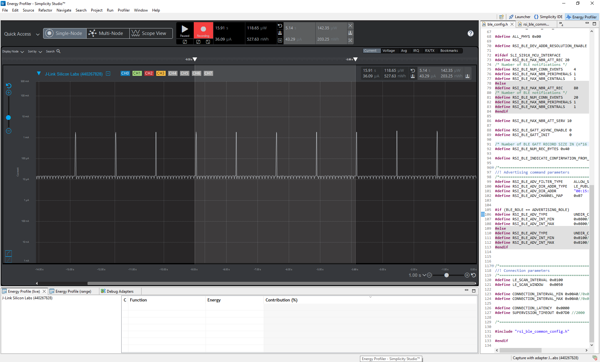<br>

5. **NCP current Consumption:**
   - As shown in the below image, the observed current consumption is 45.6uA. According to the NCP data sheet, the  expected current consumption for Advertising, Connectable in the LP chain at 0dBm is 41uA.
   <br>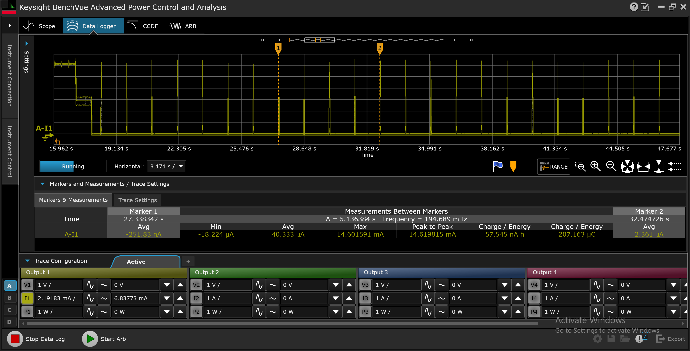<br>

6. The serial prints can see as below in any Console terminal:
   <br>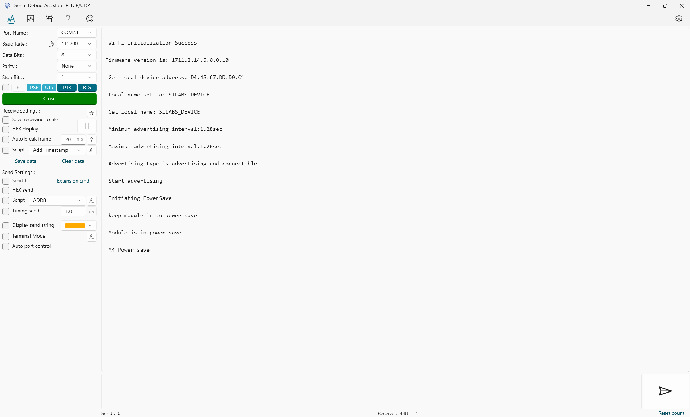<br>

## **6.5 Connection Current consumption measurement**
To measure the Connected cases current consumption measurement, The `BLE_ROLE` role should be configured as the `CONNECTION_ROLE`.

## **6.5.1 Connection Interval at 1.28sec**

1. Configure the following parameters to set up the SiWx917 module in the connection interval for every 1.28sec.
   ```c
   //!CONNECTION_INTERVAL_MIN to 1.28sec
   #define CONNECTION_INTERVAL_MIN 0x0400

   //!CONNECTION_INTERVAL_MAX to 1.28sec
   #define CONNECTION_INTERVAL_MAX 0x0400

   //!CONNECTION_LATENCY to 0
   #define CONNECTION_LATENCY  0x0000
   
   //!SUPERVISION_TIMEOUT to 20sec
   #define SUPERVISION_TIMEOUT 0x07D0

   ```
2. If the SoC is using, then the RAM retension required to be configured for the 192kB memory, please follow the steps mentioned in the [SoC Ram retension 192kB configuration](SoC-Ram-retension-192kB-configuration) section.

3. Clean, Build, Flash, run, and debug the application.
   Note: Since the SiWG917 M4 is in power save mode, please ensure that the SiWG917 device remains in ISP mode to flash the application.

4. Configure the EFR32xG21 device as a central and make the connection, please follow the steps mentioned in the [EFR32xG21 Central Configuration & Connection](EFR32xG21-Central-Configuration-&-Connection) section.

5. Open the energy profiler to measure the current conusmption numbers.

6. **SoC current Consumption:**
   - As shown in the below image, the observed current consumption is 40.49uA. According to the SoC data sheet, the  expected current consumption for Connected, Connection interval at 1.28sec in the LP chain at 0dBm is 36uA.
   <br>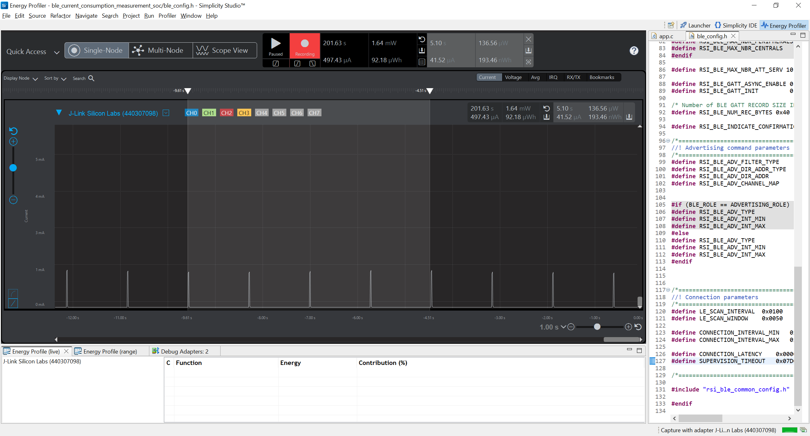<br>

7. **NCP current Consumption:**
   - As shown in the below image, the observed current consumption is 35.6uA. According to the NCP data sheet, the  expected current consumption for Connected, Connection interval at 1.28sec in the LP chain at 0dBm is 36uA.
   <br>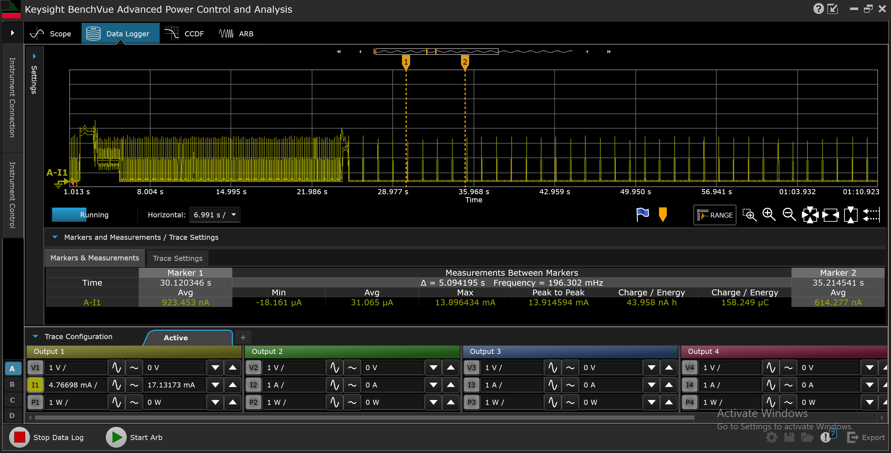<br>

8. The serial prints can see as below in any Console terminal:
   <br>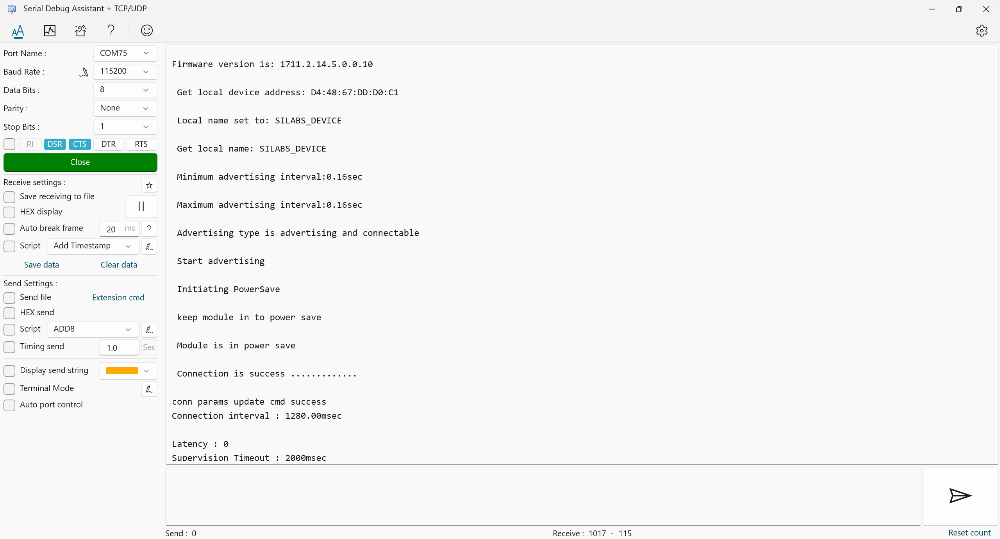<br>


## **6.5.2 Connection Interval at 200msec**

1. Configure the following parameters to set up the SiWx917 module in the connection interval for every 200msec.
   ```c
   //!CONNECTION_INTERVAL_MIN to 200msec
   #define CONNECTION_INTERVAL_MIN 0x00A0

   //!CONNECTION_INTERVAL_MAX to 200msec
   #define CONNECTION_INTERVAL_MAX 0x00A0

   //!CONNECTION_LATENCY to 0
   #define CONNECTION_LATENCY  0x0000
   
   //!SUPERVISION_TIMEOUT to 20sec
   #define SUPERVISION_TIMEOUT 0x07D0

   ```
2. If the SoC is using, then the RAM retension required to be configured for the 192kB memory, please follow the steps mentioned in the [SoC Ram retension 192kB configuration](SoC-Ram-retension-192kB-configuration) section.

3. Clean, Build, Flash, run, and debug the application.
   Note: Since the SiWG917 M4 is in power save mode, please ensure that the SiWG917 device remains in ISP mode to flash the application.

4. Configure the EFR32xG21 device as a central and make the connection, please follow the steps mentioned in the [EFR32xG21 Central Configuration & Connection](EFR32xG21-Central-Configuration-&-Connection) section.

5. Open the energy profiler to measure the current conusmption numbers.

6. **SoC current Consumption:**
   - As shown in the below image, the observed current consumption is 121.56uA. According to the SoC data sheet, the  expected current consumption for Connected, Connection interval at 200msec in the LP chain at 0dBm is 115uA.
   <br>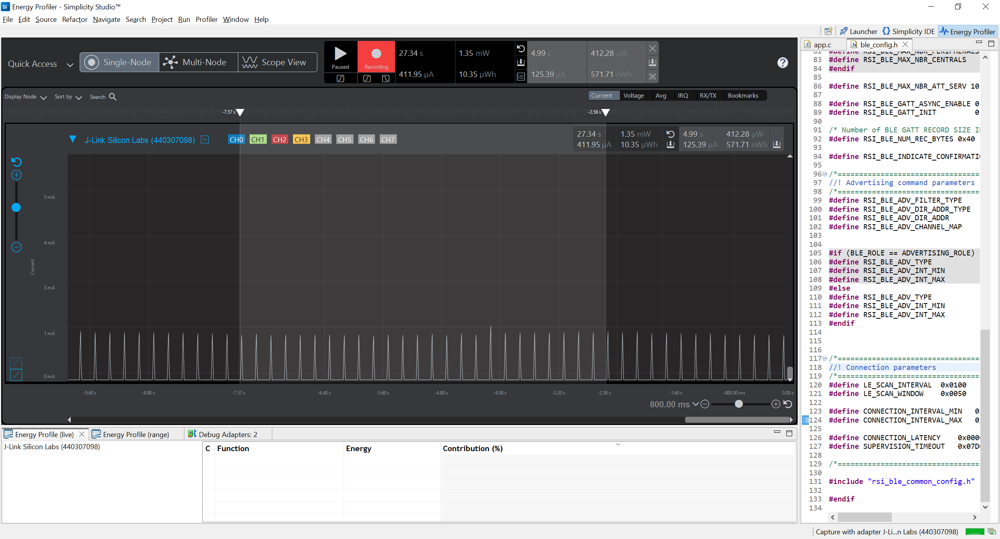<br>

7. **NCP current Consumption:**
   - As shown in the below image, the observed current consumption is 116.98uA. According to the NCP data sheet, the  expected current consumption for Connected, Connection interval at 200msec in the LP chain at 0dBm is 115uA.
   <br>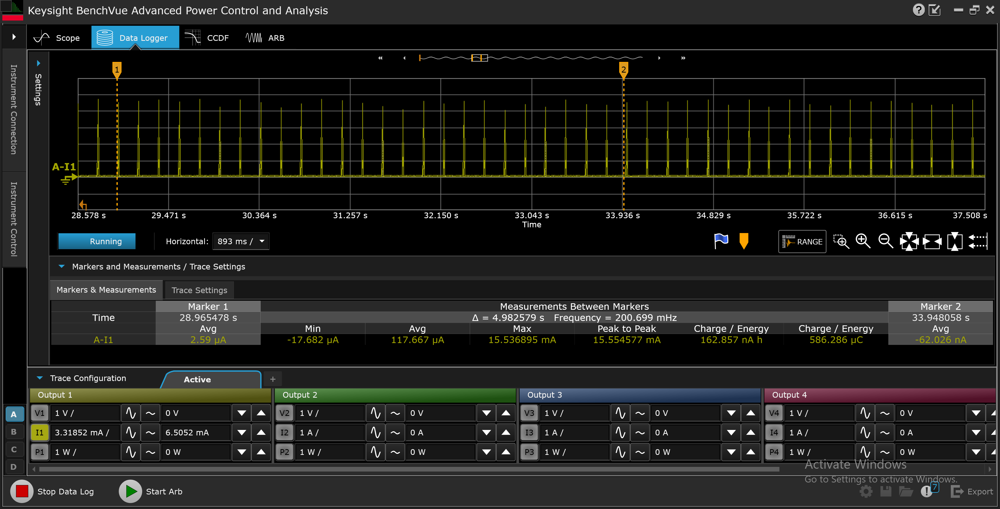<br>

8. The serial prints can see as below in any Console terminal:
   <br>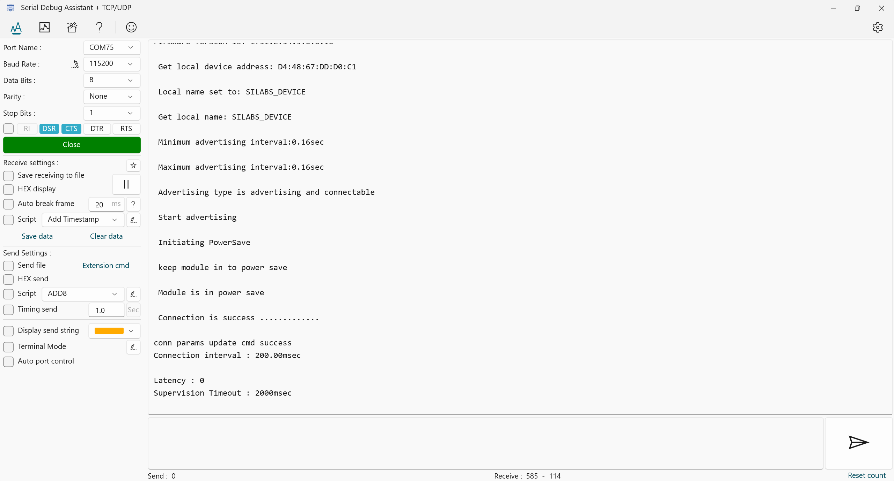<br>


# Appendix

## SoC Ram retension 192kB configuration
 
1. Open the **ble_current_consumption_measurement_soc.slcp** file and navigate to the "SOFTWARE COMPONENTS" and Search for **power** as shown in the below image.
   <br>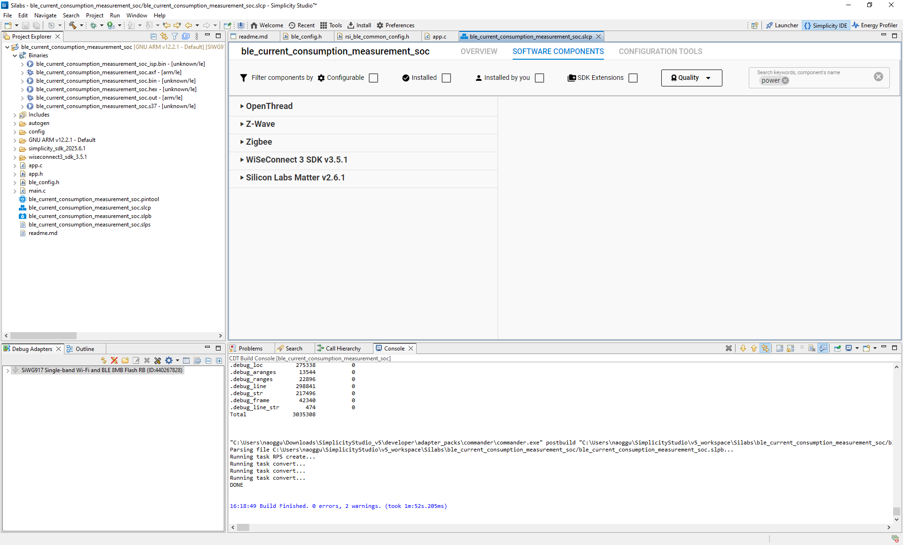<br>

2. Right click on the **WiSeConnect 3 SDK v3.4.0** and click on **Expand** option as below.
   <br>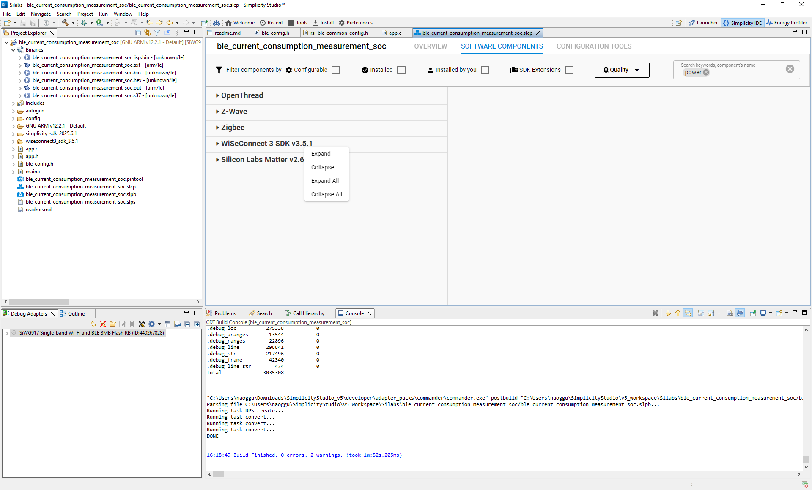<br>

3. Click on the **Power Manager Configuration** and click on the **Configure** option
   <br>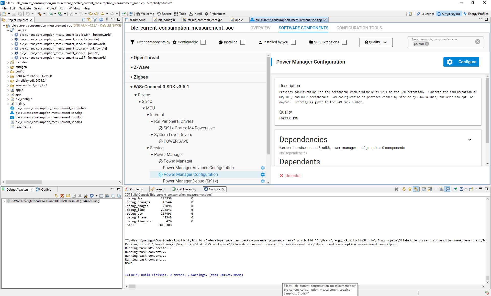<br>

4. Navigate to the **RAM Configuration** and choose the **192kB** memory in the "Low Power Ram Retention Size (in KB)" option
   <br>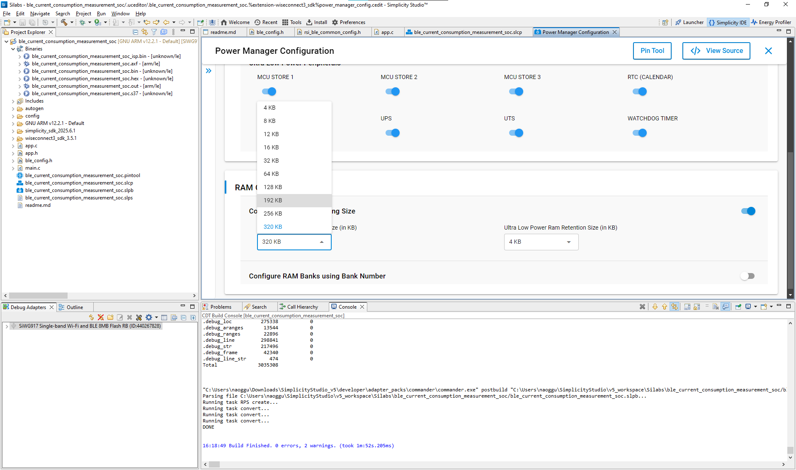<br>

5. When the 192kB memory is selected, the window will appear as shown below.
   <br>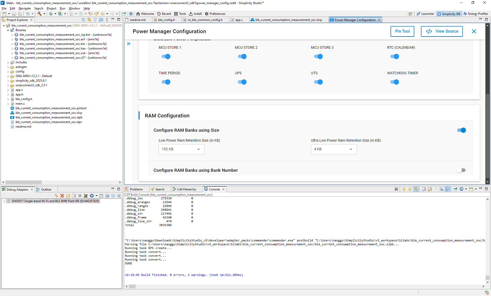<br>

## EFR32xG21 Central Configuration & Connection

1. Configure the EFR32XG21 device as a NCP device, please follow the steps mentioned in the [BT NCP](https://github.com/SiliconLabs/simplicity_sdk/tree/sisdk-2024.12/app/bluetooth/example/bt_ncp) readme file and use the **Discover - Central** tab for configuring the EFR32XG21 as a central device.
   <br>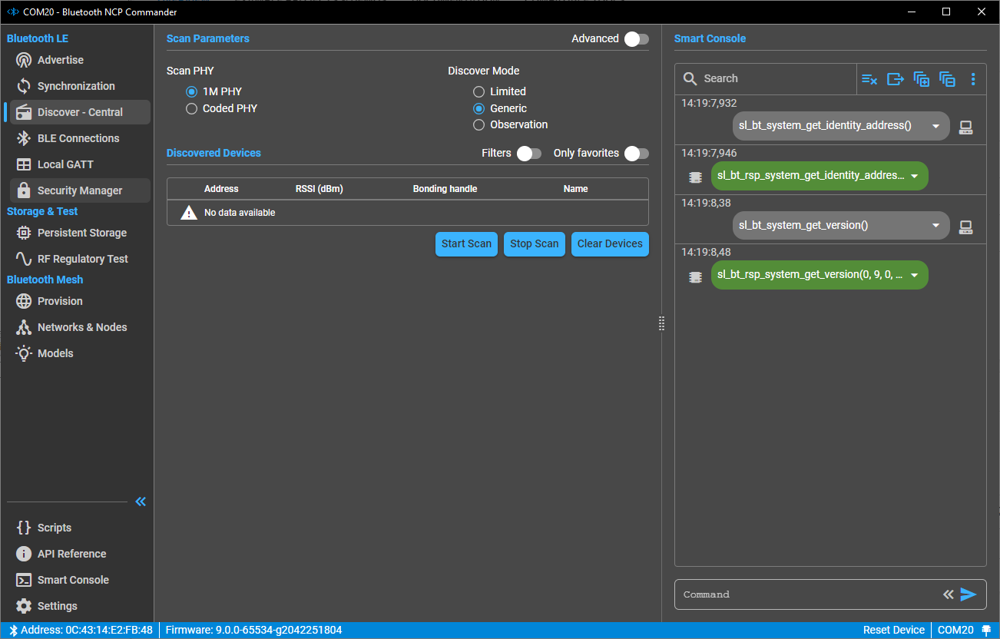<br>

2. Click on the **Start Scan** button, configure the EFR32XG21 device as central, and scan for nearby BLE devices. The scanned devices will be displayed in a list as shown below.
   <br>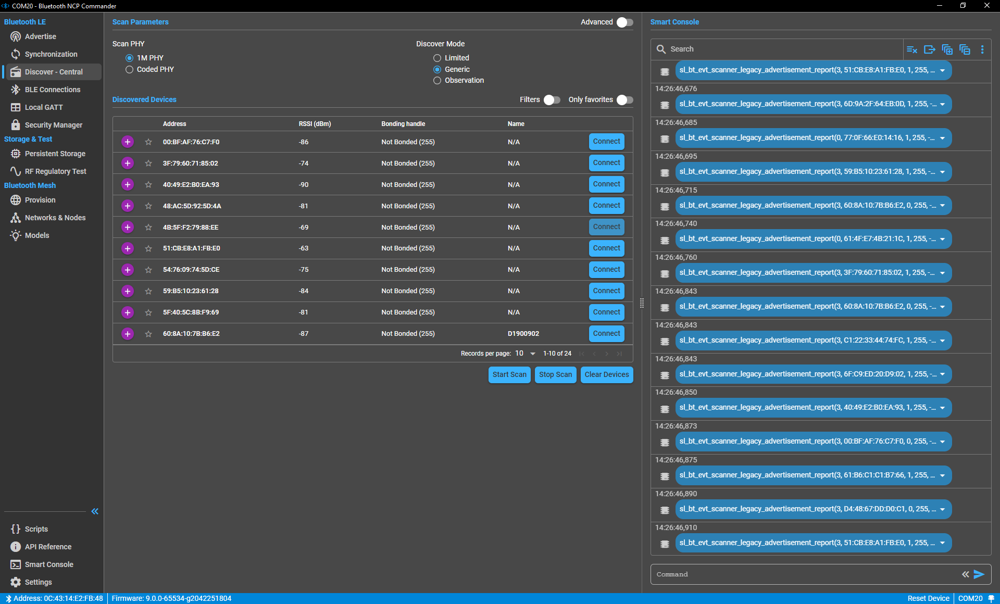<br>

3. The SiWx917 device configured as Advertisier and advertises as the "Current_consumption_number". Using the filter search for the SiWx917 device as below, 
   <br>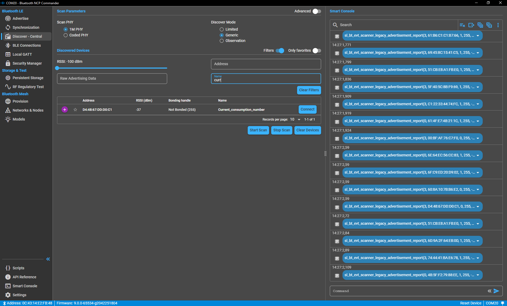<br>

4. Once the SiWx917 is found, click on the **Stop Scan** button. Then, click on the **Connect** button to initiate the connection from the EFR32XG21 device as shown in the below image.
   <br><br>

5. When the SiWx917 device is successfully connected to the EFR32XG21, the EFR32XG21 window will open as shown below.
   <br>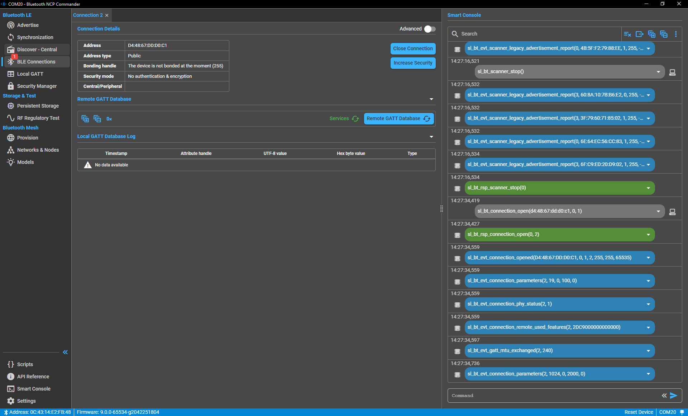<br>

