# **BLE PER Active Current Measurement**

## Table of Contents
<!-- TOC -->

- [Introduction](#1-introduction)
- [Prerequisites](#2-prerequisites)
  - [Hardware Requirements](#21-hardware-requirements)
  - [Software Requirements](#22-software-requirements)
- [Setup Diagram](#3-setup-diagram)
- [Project Creation](#4-project-creation)
  - [SiWx917 Project](#41-siwx917-project)
  - [SiWx917 SoC Project](#42-siwx917-SoC-project)
  - [SiWx917 NCP Project](#43-siwx917-NCP-project)
- [Application Configuration](#5-application-configuration)
- [Testing the Application](#6-testing-the-application)
  - [Build the Application](#61-build-the-application)
  - [Application execution](#62-application-execution)
  - [Energy Profiler settings](#63-Energy-Profiler-settings)
  - [TX Active Current Measurement](#64-TX-Active-Current-Measurement)
    - [0dBm mode](#641-0dBm-mode)
    - [8dBm mode](#642-8dBm-mode)
  - [RX Active Current Measurement](#65-RX-Active-Current-Measurement)
  - [Serial teriminal prints](#65-Serial-teriminal-prints)

<!-- /TOC -->

## **1. Introduction**

This application demonstrates the procedure to get the BLE-PER active current numbers meantioned in the datasheet.

## **2. Prerequisites**

The user must configure the following items before launching the application.

### 2.1 Hardware Requirements
- A smart phone with Silicon labs **Simplicity Connect** app
- Windows PC
#### **2.1.1 SoC** 

   - Silicon Labs SiWx917 PK6031A SoC Kit which includes
      - BRD4002A Wireless Starter Kit Mainboard
      - BRD4338A Radio Board
   
#### **2.1.2 NCP**

   - Silicon Labs BRD4346A radio board 
   - [Silicon Labs SLWSTK6006A EFR32xG21 Wireless Starter Kit](https://www.silabs.com/development-tools/wireless/efr32xg21-wireless-starter-kit) which includes
      - BRD4002A Wireless Starter Kit Mainboard
      - BRD4180A/BRD4180B Radio Board


### 2.2 Software Requirements

- SiWx917_WiSeConnect_SDK [link](https://github.com/SiliconLabs/wiseconnect)
- Simplicity Studio IDE
  - To download and install the Simplicity Studio IDE, refer to the [Simplicity Studio IDE Set up](https://docs.silabs.com/) section in ***Getting started with SiWx91x*** guides.
- Simplicity Connect application for [Android](https://play.google.com/store/apps/details?id=com.siliconlabs.bledemo&hl=en&gl=US) or [iOS](https://apps.apple.com/in/app/simplicity-connect/id1030932759)
- Docklight or Tera Term or a similar tool for reading serial prints

**Note:**
The application can be evaluated from the 3.4.0 SDK & Firmware. But it is recommended to use the latest SDK & Firmware available on the website.

## **3. Setup Diagram**
- This section describes the setup diagram of the BLE PER active current numbers measurement.
   <br>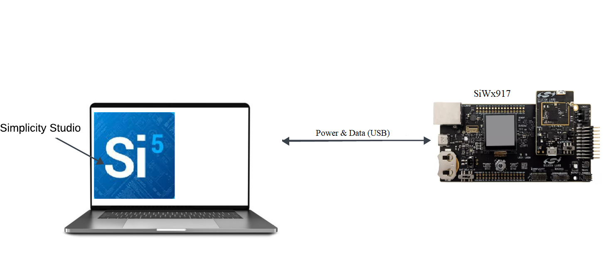<br>

- Follow the "Hardware connections and Simplicity Studio IDE Set up" section in the respective [Getting Started with SiWx91x](https://docs.silabs.com/wiseconnect/3.0.9/wiseconnect-getting-started/getting-started-with-soc-mode) guides to make the hardware connections and add the Gecko and SiWx91x WiFi SDK to the Simplicity Studio IDE.

- Ensure the SiWx91x module is loaded with the latest firmware following the [SiWx91x Firmware Update](https://docs.silabs.com/rs9116/latest/wiseconnect-getting-started) section in the respective ***Getting started with SiWx91x*** guides. Please note that the current project was tested on SiWx917_WiSeConnect_SDK.3.5.1(SiWG917-B.2.14.5.0.0.10.rps).

## **4. Project Creation**

### 4.1 SiWx917 Project

- Refer to the instructions [here](https://docs.silabs.com/wiseconnect/latest/wiseconnect-getting-started/) to:

  - Install Studio and WiSeConnect 3 extension
  - Connect your device to the computer
  - Upgrade your connectivity firmware
  - Create a Studio project

- Download the project **iot-pa-ble_per_active_current_measurement** from the GitHub [link](https://github.com/SiliconLabs/wifi_combo_applications/tree/master/SiWx917)
- Keep the project in the Release folder at location: `SDK/examples/snippets/ble/`
- Open **templates.xml** file located at `SDK/templates.xml` and add the code snippet at the end, before `</model:MDescriptors>`:

```sh
<descriptors name="ble_per_active_current_measurement_soc" label="BLE - PER Active Current measurement(SoC)" description="This application demonstrates the procedure to get the BLE-PER active current numbers meantioned in the datasheet.">
    <properties key="namespace" value="template.uc"/>
    <properties key="keywords" value="universal\ configurator"/>
    <properties key="projectFilePaths" value="examples/snippets/ble/ble_per_active_current_measurement/ble_per_active_current_measurement_soc.slcp"/>
    <properties key="boardCompatibility" value="com.silabs.board.none brd2605a brd4338a brd4342a brd4340a brd4343a brd4343b brd4339b brd4340b brd4341a brd4343q brd2708a brd2911a brd4344a brd4344b"/>
    <properties key="partCompatibility" value=" .*si917.* .*siwg917m111mgtba.* .*siwg917m141xgtba.* .*siwg917y111mgab.* .*siwg917y111mgnba.* .*siwg917y121mgnb.* .*siwg917m121xgtba.* .*siwg917m111xgtba.* .*siwg917m100mgtba.* .*siwg917m100xntba.* .*siwg917m110lgtba.* .*siwg917y110lgnba.* .*siwg915m000mgtba.* .*siwg915m000lgtba.*"/>
    <properties key="ideCompatibility" value="makefile-ide simplicity-ide visual-studio-code generic-template"/>
    <properties key="toolchainCompatibility" value="gcc"/>
    <properties key="quality" value="production"/>
    <properties key="category" value="Example|Wi-Fi"/>
    <properties key="stockConfigCompatibility" value="com.silabs.ss.framework.project.toolchain.core.default"/>
    <properties key="sdkAndProtocolTags" value=""/>
    <properties key="readmeFiles" value="examples/snippets/ble/ble_per_active_current_measurement/readme.md"/>
	<properties key="filters" value="Device\ Type|SoC Wireless\ Technology|Bluetooth Project\ Difficulty|Beginner"/>
  </descriptors>
<descriptors name="ble_per_active_current_measurement_ncp" label="BLE - PER Active Current measurement (NCP)" description="This application demonstrates the procedure to get the BLE-PER active current numbers meantioned in the datasheet.">
    <properties key="namespace" value="template.uc"/>
    <properties key="keywords" value="universal\ configurator"/>
    <properties key="projectFilePaths" value="examples/snippets/ble/ble_per_active_current_measurement/ble_per_active_current_measurement_ncp.slcp"/>
    <properties key="boardCompatibility" value="com.silabs.board.none brd4180a brd4180b brd4186c"/>
    <properties key="partCompatibility" value=" mcu.arm.efr32.mg21.* mcu.arm.efr32.mg21.* mcu.arm.efr32.mg24.* mcu.arm.efr32.fg25.*"/>
    <properties key="ideCompatibility" value="makefile-ide simplicity-ide visual-studio-code generic-template"/>
    <properties key="toolchainCompatibility" value="gcc"/>
    <properties key="quality" value="production"/>
    <properties key="category" value="Example|Wi-Fi"/>
    <properties key="stockConfigCompatibility" value="com.silabs.ss.framework.project.toolchain.core.default"/>
    <properties key="sdkAndProtocolTags" value=""/>
    <properties key="readmeFiles" value="examples/snippets/ble/ble_per_active_current_measurement/readme.md"/>
	<properties key="filters" value="Device\ Type|NCP Wireless\ Technology|Bluetooth Project\ Difficulty|Beginner"/>
  </descriptors>
```

- Refresh the Gecko SDK.
<br>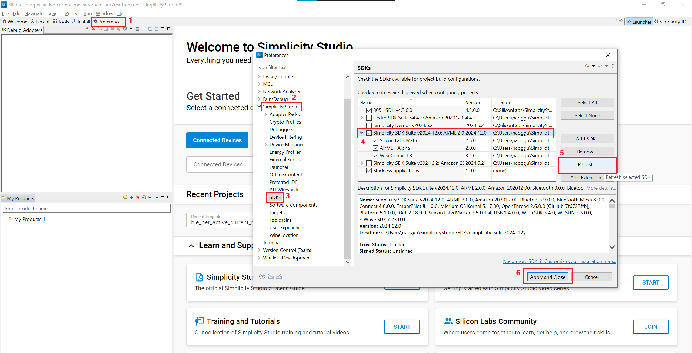<br>

### 4.2 SiWx917 SoC Project

- Connect the SiWx917 SoC kit and create the project.
<br>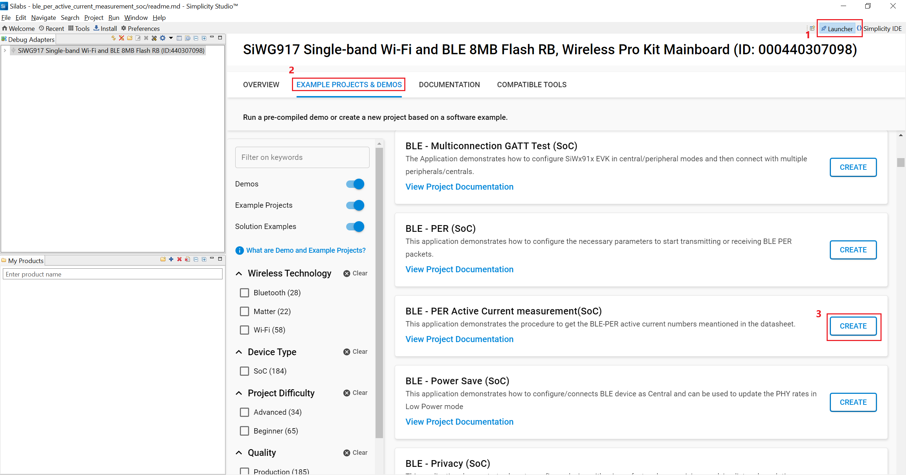<br>

### 4.3 SiWx917 NCP Project
- Connect the SiWx917 SoC kit and create the project.
<br>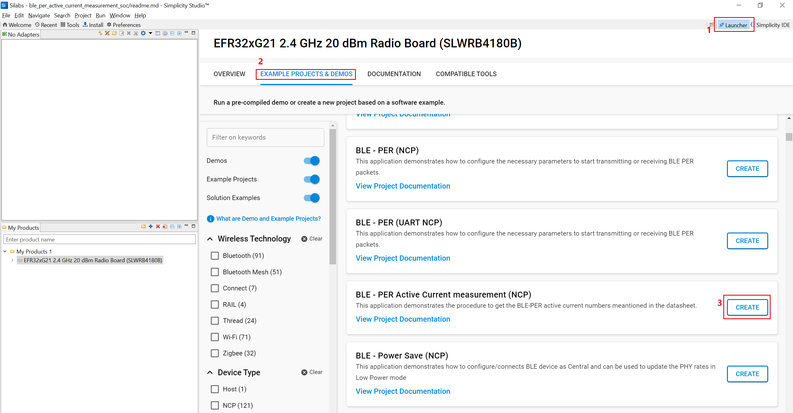<br>

## **5. Application Configuration**

The application can be configured to suit you requirements and development environment. Go through the following sections and make any changes if needed.

- In the Project explorer pane of the IDE, expand the **ble\_per\_active\_current\_measurement\_soc** folder and open the **ble\_config.h** file. 
   ```c
   //! RSI_CONFIG_PER_MODE Refer to the SiWx91x module PER Mode either "RSI_BLE_PER_TRANSMIT_MODE" or "RSI_BLE_PER_RECEIVE_MODE".
   #define RSI_CONFIG_PER_MODE RSI_BLE_PER_TRANSMIT_MODE

   //! BLE_TX_PKT_LEN Refer to the Length of the packet to be transmitted.
   #define BLE_TX_PKT_LEN       240

   //! BLE_PHY_RATE Refer to the Phy rate at which packets are transmitted
   #define BLE_PHY_RATE         LE_ONE_MBPS

   //! BLE_TX_POWER_INDEX Refer to the Power of the packet to be transmitted
   #define BLE_TX_POWER_INDEX   31

   //! BLE_TRANSMIT_MODE Refer to the Transmit mode to be used either "BURST_MODE" or "CONTIUOUS_MODE"
   #define BLE_TRANSMIT_MODE    CONTIUOUS_MODE

   //! BLE_RF_CHAIN Refer to the chain selection either "BT_LP_CHAIN_BIT" or "BT_HP_CHAIN_BIT"
   #define BLE_RF_CHAIN         BT_LP_CHAIN_BIT

   //! SCRAMBLER_SEED Refer to the Initial seed to be used for whitening, Use 5 for the continuous mode
   #define SCRAMBLER_SEED     5

   //! BLE_RX_CHNL_NUM Refer to the RX channel number
   #define BLE_RX_CHNL_NUM    10

   // BLE_TX_CHNL_NUM Refer to the TX channel number
   #define BLE_TX_CHNL_NUM    10
   ```
   <br>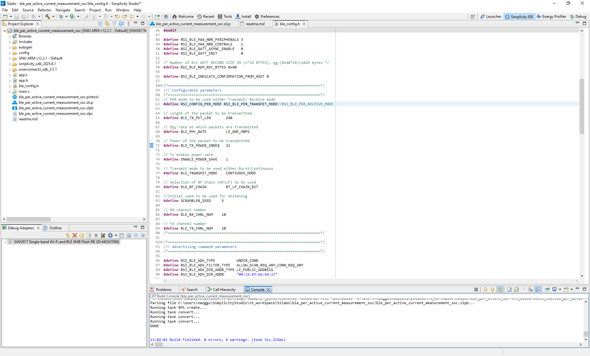<br>


## **6. Testing the Application**

This section outlines the application's step-by-step execution process.

### **6.1 Build the Application**

- After creating the project, either right-click on it and choose "Build Project" or click the build icon (a hammer) to begin building the project.
   <br>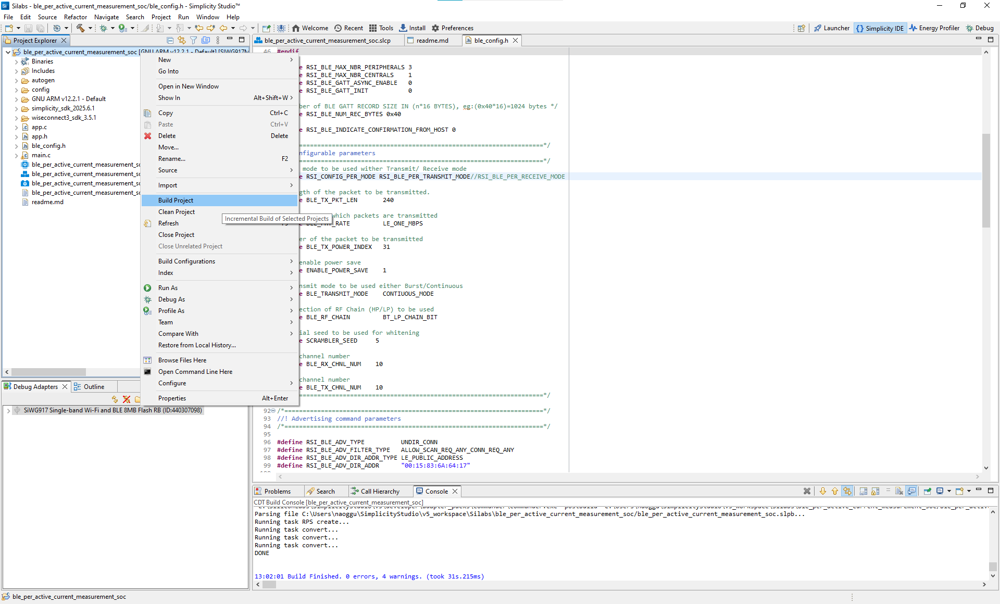<br>


## **6.2 Application execution**

1. After the program gets executed, If the SiWx91x device is configured in BLE-PER-TX Mode, the SiWx91x device sends the packets with the configured mode in the configured channel.


2. The BLE-PER-RX can be validated between two SiWx91x device modes.

   - Configure an SiWx91x device in PER-TX mode and configure another SiWx91x device in BLE PER RX mode.

3. Check the BLE PER stats to see if configured values are affected or not.
 
      **Note:** A 10% variance in current consumption is acceptable.

## **6.3 Energy Profiler settings**
1. For monitoring power consumption, navigate to "Tools" and select "Energy Profiler" as shown below.
   <br>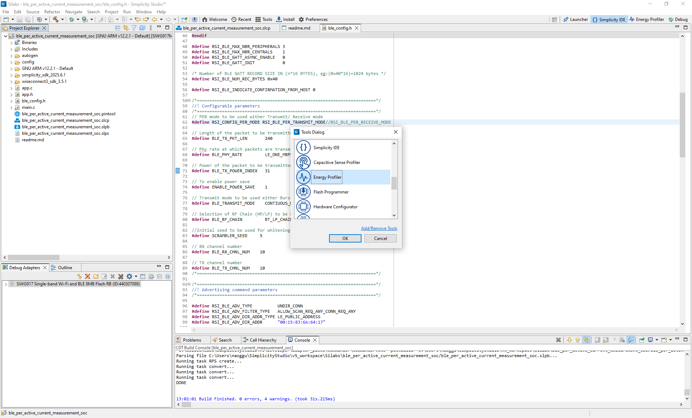<br>
2. Click on "Quick Access" and then "Start Energy Capture" to begin capturing power consumption data.
   <br>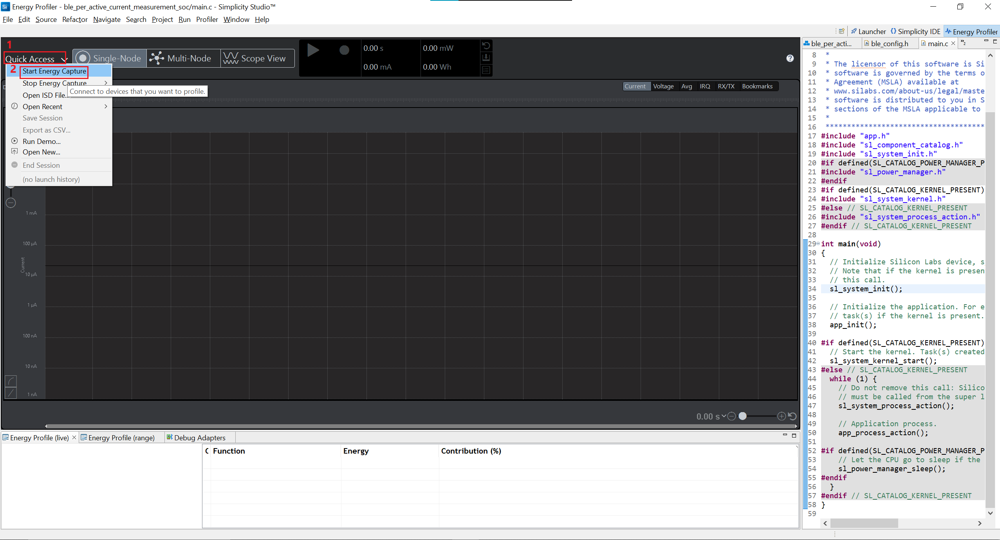<br>
3. The device selection pop-up will appear as shown below. Please select the device and click "OK".
   <br>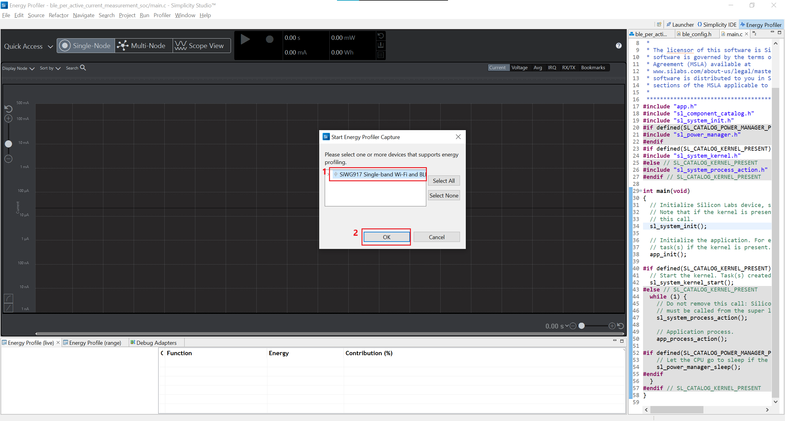<br>
4. **NCP current Consumption:**
   - According to the "AEM-Based Current Measurement" method, the current consumption of the host and SiWN917 will be measured separately and manually calculated using the following formula:
     ```c
      I(SiWx917) = I(total) - I(host)
      ```  
   - Refer to the "AEM-Based Current Measurement" section in the "an1433 siwx917 ncp low power application note" for the measurement procedure.


## **6.4 TX Active Current Measurement**
The TX active current measurements provide insights into the current consumed by the device during data transmission at 0dBm and 8dBm power levels.
## **6.4.1 0dBm mode**
1. By default, the example is configured to measure power consumption in the LP chain. 
   Note: Ensure the power index(`BLE_TX_POWER_INDEX`) is set to 31.

2. **SoC current Consumption:**
   - As shown in the below image, the observed TX power is 9.35mA. According to the SoC data sheet, the  expected power consumption for PER-TX in the LP chain at 0dBm is 10mA.
   <br>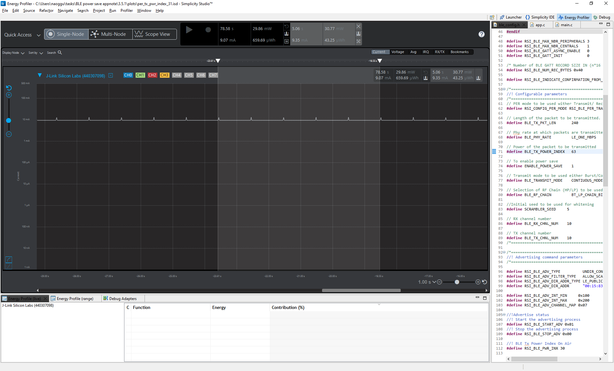<br>

3. **NCP current Consumption:**
   - **Total current consumption:**
      <br>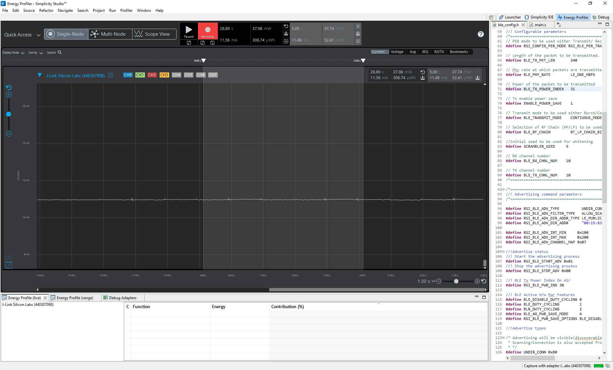<br>  

   - **Host current consumption:**
      <br>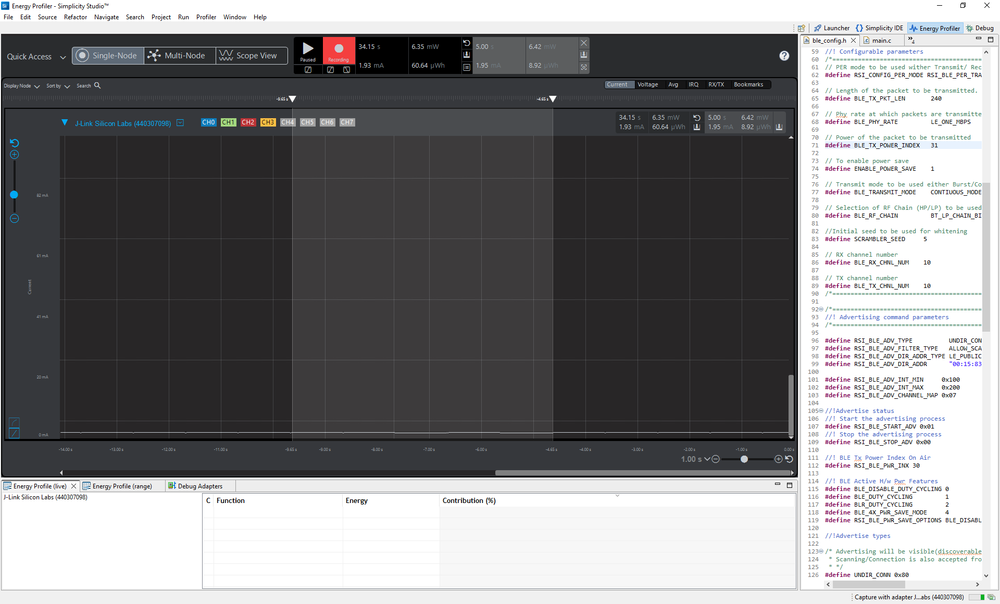<br>  
   - **SiWN917 current consumption:** As shown in the below, the observed TX power is 9.54mA. According to the NCP data sheet, the  expected power consumption for PER-TX in the LP chain at 0dBm is 10mA.
   
      ```c
         I(SiWx917) = I(total) - I(host)
         I(SiWx917) = 11.49 mA - 1.95 mA => 9.54 mA
      ```


## **6.4.2 8dBm mode**
1. Change the power index(`BLE_TX_POWER_INDEX`) is set to 63. 

2. Build, Flash, run, and debug the application.
   Note: Since the SiWG917 M4 is in power save mode, please ensure that the SiWG917 device remains in ISP mode to flash the application.

3. **SoC current Consumption:**
 - As shown in the below image, the observed TX power is 16.17mA. According to the SoC data sheet, the  expected power consumption for PER-TX in the LP chain at 8dBm is 17mA.
   <br>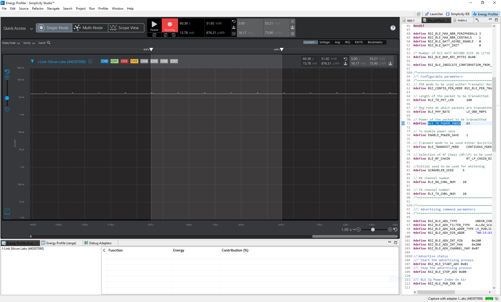<br>
4. **NCP current Consumption:**
   - **Total current consumption:**
      <br>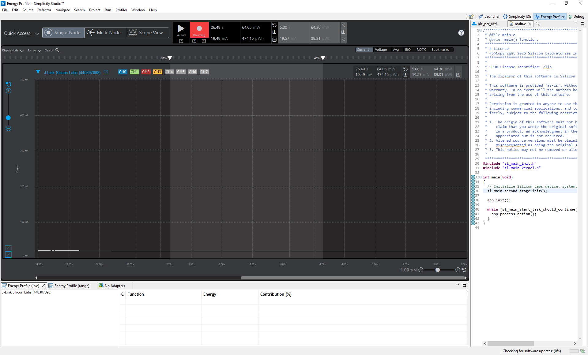<br>  

   - **Host current consumption:**
      <br><br>  
   - **SiWN917 current consumption:** As shown in the below, the observed TX power is 17.62mA. According to the NCP data sheet, the  expected power consumption for PER-TX in the LP chain at 8dBm is 17mA.
   
      ```c
         I(SiWx917) = I(total) - I(host)
         I(SiWx917) = 19.57 mA - 1.95 mA => 17.62 mA
      ```

## **6.5 RX Active Current Measurement**
The RX active current measurements provide insights into the current consumed by the device during data reception.
1. Change the `RSI_CONFIG_PER_MODE` to `RSI_BLE_PER_RECEIVE_MODE`.

2. According to the PER-TX device, change the `BLE_RX_CHNL_NUM`. By default, the application configured to the 10 channel.

3. Build, Flash, run, and debug the application.
   Note: Since the SiWG917 M4 is in power save mode, please ensure that the SiWG917 device remains in ISP mode to flash the application.

4. **SoC current Consumption:**
   - As shown in the below image, the observed TX power is 10.45mA. According to the SoC data sheet, the expected power consumption for PER-RX in the LP chain is 10mA.

   <br>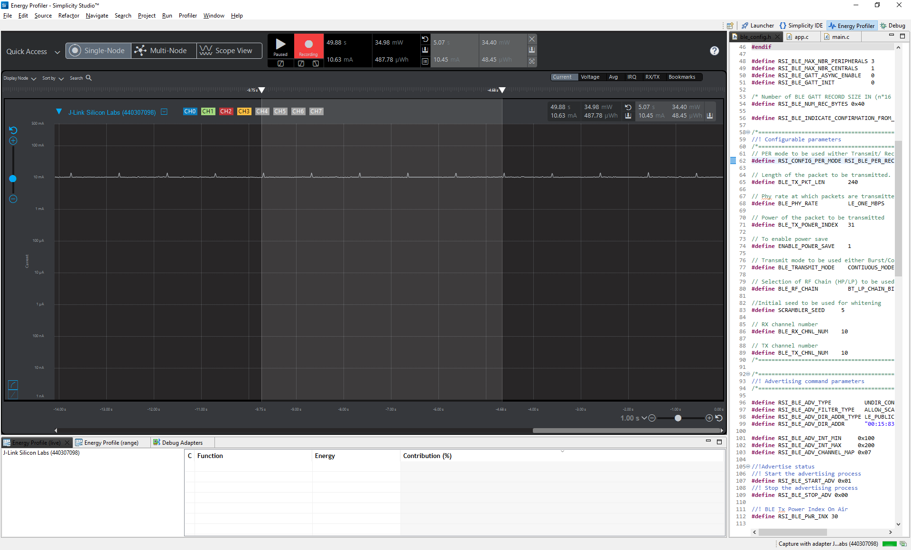<br>

5. **NCP current Consumption:**   
     - **Total current consumption:**
      <br><br>  

   - **Host current consumption:**
      <br><br>  
   - **SiWN917 current consumption:** As shown in the below, the observed TX power is 10.54mA. According to the NCP data sheet, the expected power consumption for PER-RX in the LP chain is 10mA.
   
      ```c
         I(SiWx917) = I(total) - I(host)
         I(SiWx917) = 11.49 mA - 1.95 mA => 10.54 mA
      ```

## **6.6 Serial teriminal prints**
- The serial prints for the "TX Active Current Measurement" can see as below in any Console terminal
   - **0dBm mode:**
   <br>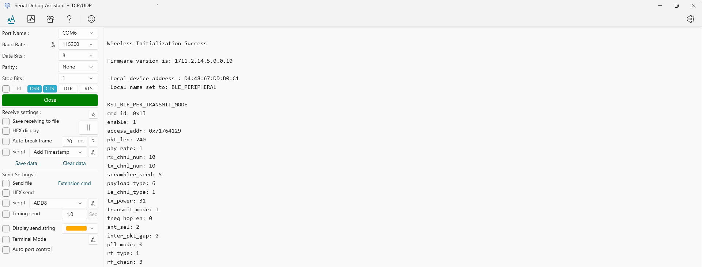<br>
   - **8dBm mode:**
   <br>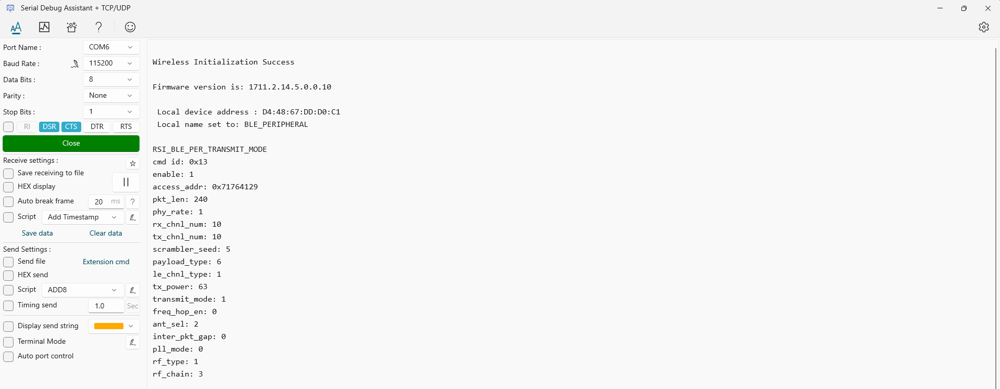<br>

- The serial prints for the "RX Active Current Measurement" can see as below in any Console terminal
<br>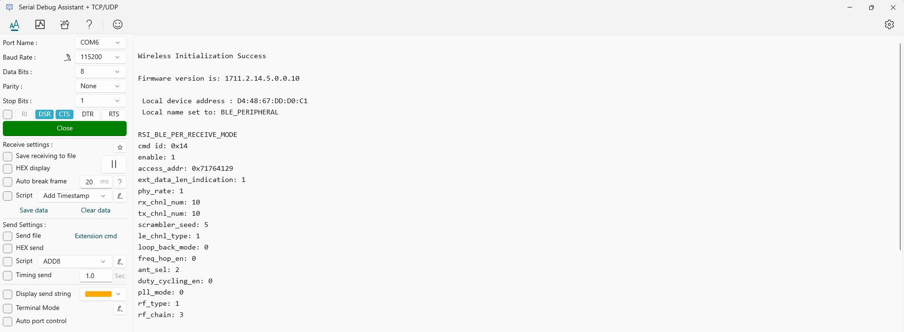<br>