# Controlling Smart Lock with Voice Commands
Users can control their smart lock using voice commands through [Google Assistant](https://play.google.com/store/apps/details?id=com.google.android.apps.googleassistant&hl=en-IN&gl=US). Google Assistant is one of the most popular services that can be integrated with [IFTTT](https://play.google.com/store/apps/dev?id=8591752306381892167&hl=en-US) to control IoT devices like Smart Lock. Through IFTTT, users can create custom applets that link voice commands given to Google Assistant with actions on [Adafruit.IO](https://io.adafruit.com/). For example, saying **"Ok Google, lock the door"** can trigger an IFTTT applet that sends a lock command to Adafruit, which then communicates with the SiWG917 Smart Lock device.

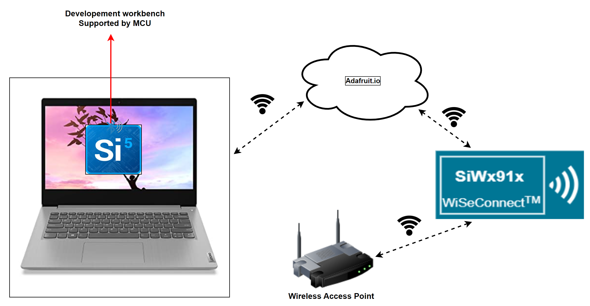

This requires cloud communication with Adafruit, which can be handled efficiently by the Wiseconnect SDK's internal Embedded MQTT library, allowing seamless message exchange with Adafruit's MQTT broker.

- Install the **MQTT Client** software component in your project to enable MQTT communication functionality.

    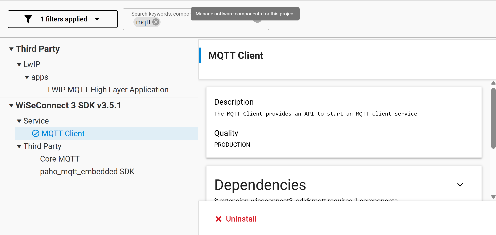

- Enable **SL_SI91X_EXT_EMB_MQTT_ENABLE** feature bitmap under **ext_tcp_ip_feature_bit_map** in the SiWG917 boot config to enable embedded/internal MQTT functionality to connect with Adafruit.io server.

Information regarding feature bitmaps is available [here](https://docs.silabs.com/wiseconnect/latest/wiseconnect-api-reference-guide-si91x-driver/si91-x-extended-tcp-ip-feature-bitmap).

## Configure Adafruit Server for Smart Lock
- Click [here](https://io.adafruit.com/) to open Adafruit.io in a browser and Click on **Sign in**.
- Follow intruction in this [link](https://learn.adafruit.com/adafruit-io-basics-dashboards/creating-a-dashboard) to create a **Dashboard**.

    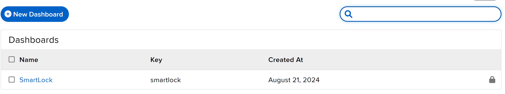

- Click on the newly created **SmartLock** dashboard and click on Settings icon. From the dropdown, click on **Create New Block** to add a new block to your Dashboard. 

    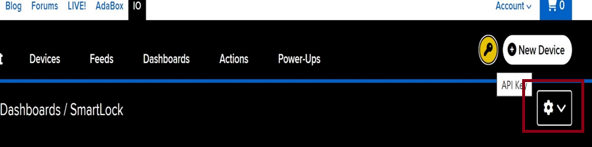 

    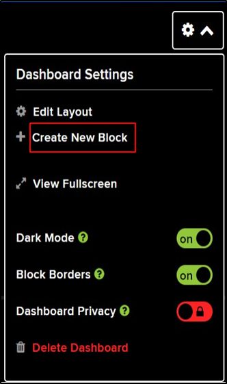

- Click on first Toggle block.

    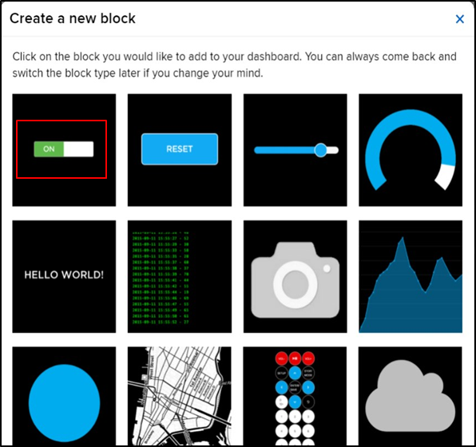

- Now you will be prompted to create a feed. Feeds here are similar to topics in AWS IoT Core. Create the feeds that you'd like to connect to your block.

    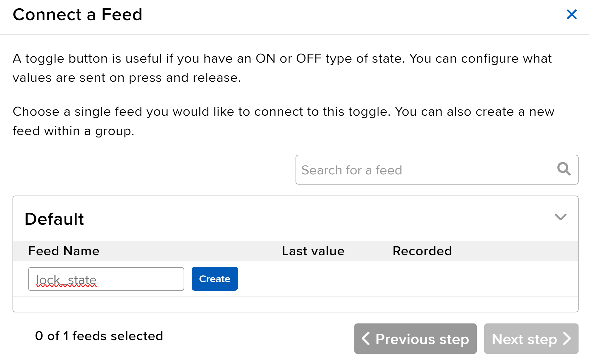

- Similarly you can create multiple feeds.

    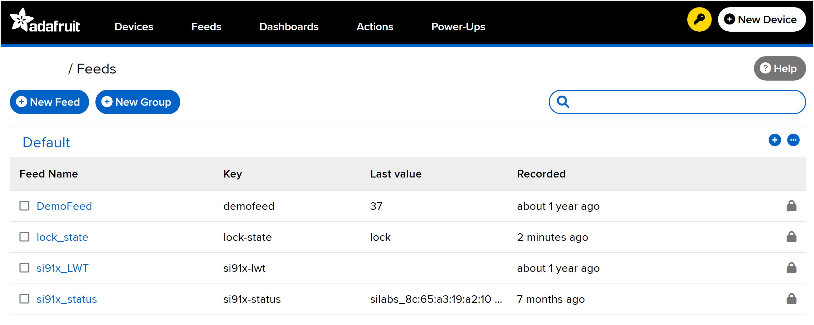

- Click on the checkbox next to the feed to select it and click the **Next Step** button to continue.

    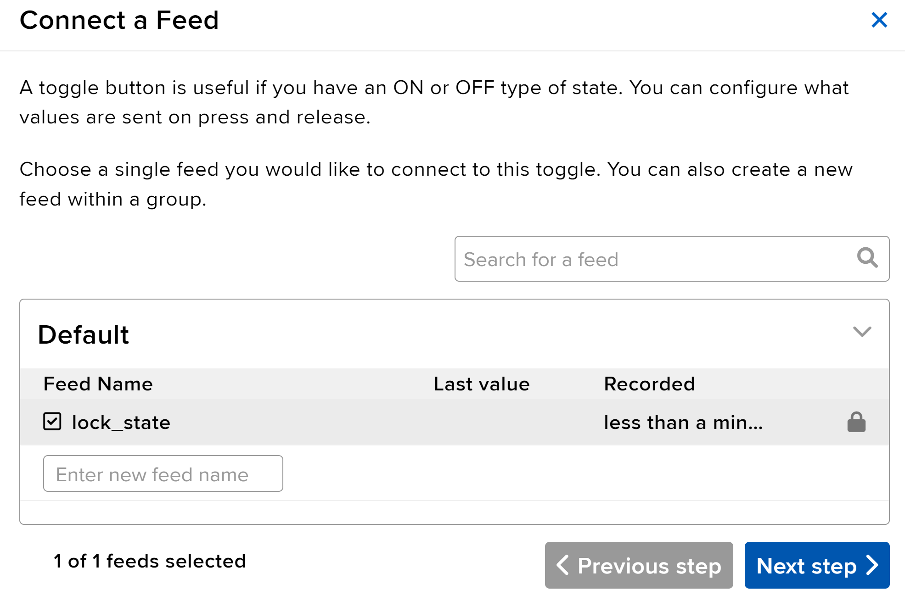

- You can customize the settings for the block type you selected. Provide details and click on **Create block**.

    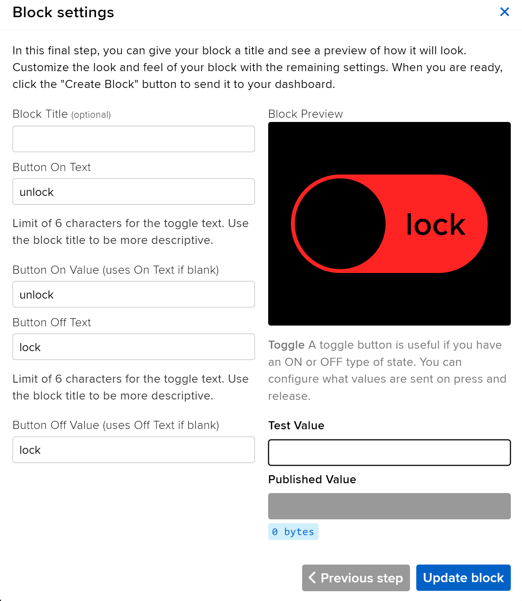

- A toggle block would be added to the **SmartLock** dashboard as shown below.

    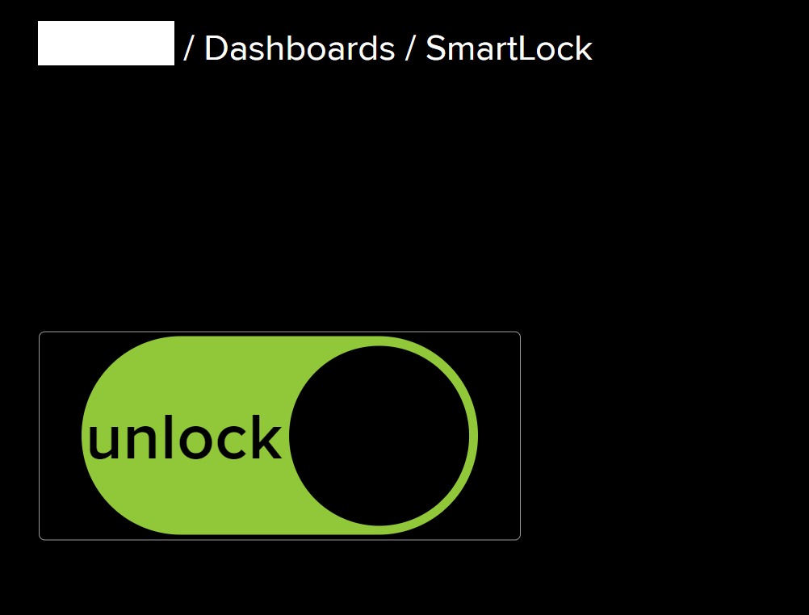

- Click on the **Key** Symbol on top right and copy the **Username** and **Active Key** in a safe file.

    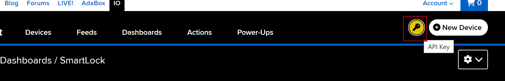

- This **Username** and **Active key** will be used in the application to connect to Adafruit.io.

    **NOTE:** Keep this key safe, if someone has your key then all your data can be accessed and altered easily.

    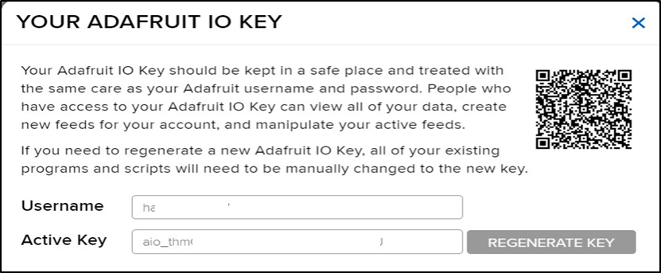

- Navigate to `app.h` file in the project and disable **AWS** and enable **Adafruit**.

    ```c
    #define AWS          0
    #define ADAFRUIT     1
    ```
- Open **wifi_app.h** file and provide the Adafruit feeds(in publish, subscribe and LWT topics), IO Key(in username and password). These details are required during MQTT connection and data transfer.
Your topic would be according to your username and feed name, generic topic name format is <username>/feeds/<feed name>.
For e.g., if your username is “david” and your feed name (which you made in above steps) is “lock_state”, then your topic would be “david/feeds/lock_state”.

    **Note:** Ensure the IP address of **io.adafruit.com** is set correctly.

    ```c
    #if ADAFRUIT

    #include "sl_mqtt_client.h"

    #define MQTT_BROKER_IP "52.54.110.50"//"io.adafruit.com"

    #define MQTT_BROKER_PORT 1883

    #define CLIENT_PORT 1

    #define SUBSCRIBE_TOPIC        "username/feeds/lock_state"
    #define QOS_OF_SUBSCRIPTION    SL_MQTT_QOS_LEVEL_0

    #define PUBLISH_TOPIC          "username/feeds/si91x_status"
    #define PUBLISH_MESSAGE        "SmartLock is Active"
    #define QOS_OF_PUBLISH_MESSAGE 0

    #define IS_DUPLICATE_MESSAGE 0
    #define IS_MESSAGE_RETAINED  0
    #define IS_CLEAN_SESSION     0

    #define LAST_WILL_TOPIC       "username/feeds/si91x_LWT"
    #define LAST_WILL_MESSAGE     "SmartLock has been disconnected from network"
    #define QOS_OF_LAST_WILL      0
    #define IS_LAST_WILL_RETAINED 0

    #define ENCRYPT_CONNECTION     0
    #define CERTIFICATE_INDEX      0
    #define KEEP_ALIVE_INTERVAL    2000
    #define MQTT_CONNECT_TIMEOUT   5000
    #define MQTT_KEEPALIVE_RETRIES 0

    #define SEND_CREDENTIALS 1

    //Provide Adafruit IO key details
    #define USERNAME "username"
    #define PASSWORD "userpwd"

    #endif

    ```

- The lock/unlock requests from Adafruit server are received in **mqtt_client_subscribe_handler**, users can implement their custom logic and perform motor operations.

    ```c
    void mqtt_client_subscribe_handler(void *client, sl_mqtt_client_message_t *message, void *context)
    {
    LOG_PRINT("Data received from Adafruit Server: ");

    //User logic
    if (!strncmp ((char *)message->content, "lock",message->content_length))
    {
        blue_led();
        lock();               //drive motor to lock
    }

    if (!strncmp ((char *)message->content, "unlock",message->content_length))
    {
        red_led();
        unlock();              //drive motor to unlock
    }
    else if(!strncmp ((char *)message->content, "erase",message->content_length))
    {
        sl_mqtt_client_disconnect(client, 0);   //Disconnect from MQTT
        erase_credentials();                    // Erase Wi-Fi credentials in NVM3 region
    }
    osSemaphoreRelease(data_received_semaphore);
    }
    ```

- Upon build and flashing the application you can follow this link to open [console logs](https://docs.silabs.com/wiseconnect/latest/wiseconnect-developers-guide-developing-for-silabs-hosts/using-the-simplicity-studio-ide#console-input-and-output).

- Device advertises as **BLE_CONFIGURATOR**. Do **Wi-Fi Commissioning** from **Si Connect** App to connect to a Wi-Fi.
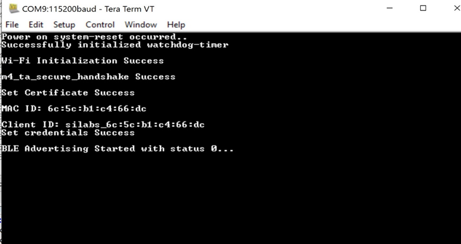

- If Wi-Fi is already commissioned, association with AP and Adafruit MQTT connection will happen.
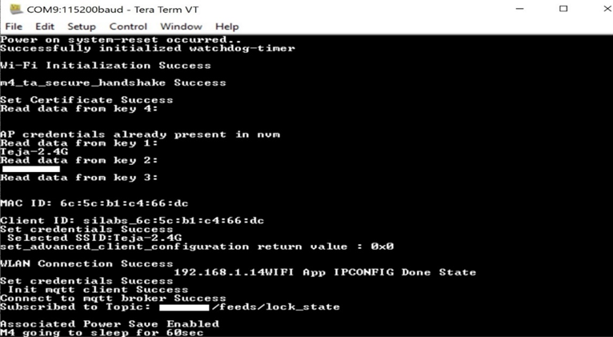

- Now open the Adafruit IO dashboard and click on the toggle switch to control your SiWG917 Smart Lock device remotely.

    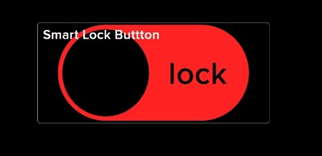

- During this you can observe Smart Lock receiving commands on the serial console.
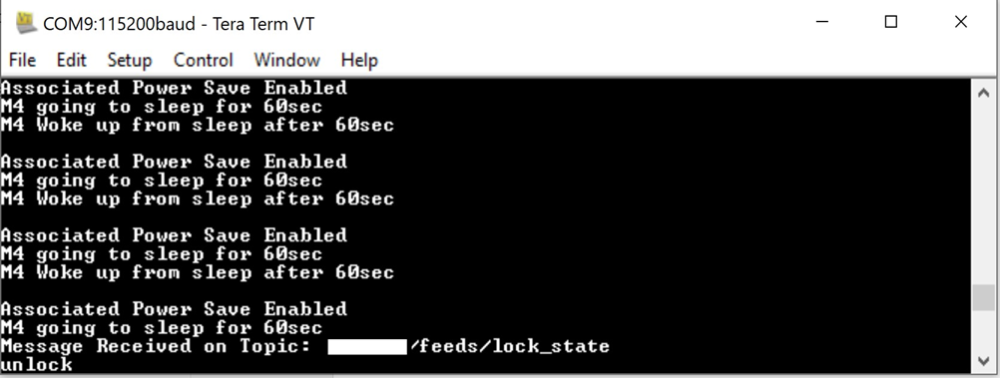

## IFTTT Configuration
At this point, we have established a functioning smart lock system with a web-based control interface through Adafruit.io, allowing users to lock or unlock the device remotely from web browser. While this provides a complete IoT solution, we can enhance the user experience by adding voice control capabilities through Google Assistant over mobile phone. To bridge the gap between voice commands and the smart lock hardware, we will use IFTTT (If This Then That) to create automation applets that translate spoken commands into MQTT messages sent to our Adafruit.io feeds.

- To begin, click the **Create** button in the upper right of the screen in the IFTTT App.
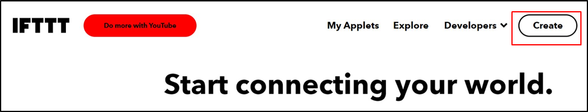

- The first time you connect to a service like Google Assistant, or Adafruit IO, you will be prompted to connect to that service with your login name and password.

- Open IFTTT app in your Mobile and click on Log in.
If you don’t have an account, click on [Continue with Apple, Google, or Facebook](https://ifttt.com/session/new) to make a new account.

## Google Assistant Setup
Here are the steps to configure Google Assistant with IFTTT. You will need to create two applets, one to lock the door and the other to unlock the door.

- Click on **If This** to create the first half of the applet.

    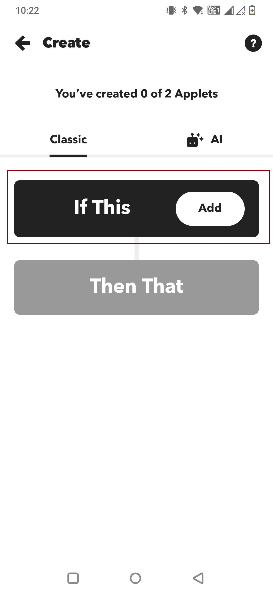

- Search for and select **Google Assistant** as a trigger service. Don't be tempted to select **Adafruit** yet! We will be selecting that in the second half of the applet.

    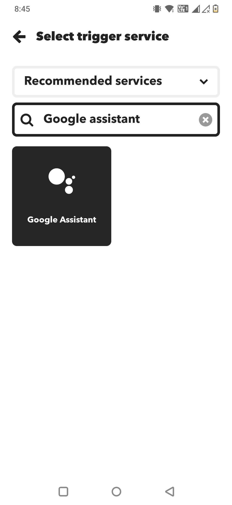

- After selecting Google Assistant, you will see a **Select trigger** screen. Click on **Activate scene** to configure trigger.

    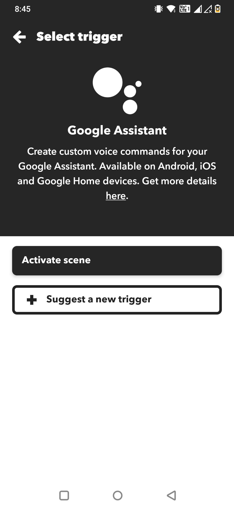

- In the next screen, you can configure the trigger fields. Here, the **Scene name** entered will be the phrase used while giving a voice command from Google Assistant. Enter **lock door** in the scene name and click on **Continue**.

    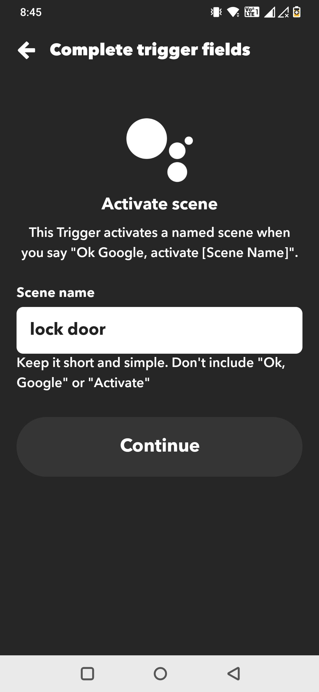

- Click **That** to create the second half of the applet. Notice the Google Assistant icon in the **If** part of the applet.

    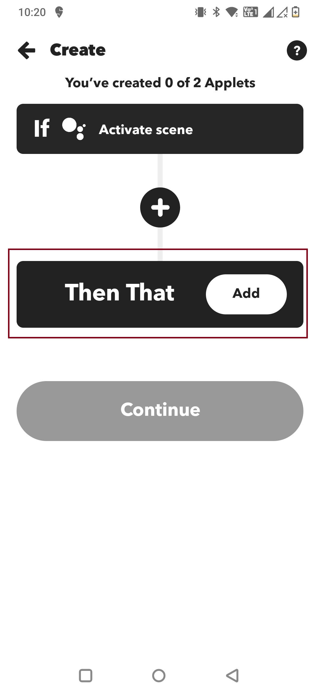

- Here is where we connect our applet to Adafruit IO. Select the **Adafruit** icon from the list of action services.

    

- After selecting Adafruit, click on **Send data to Adafruit IO** action. This enables IFTTT to communicate with your Adafruit.io feeds.

    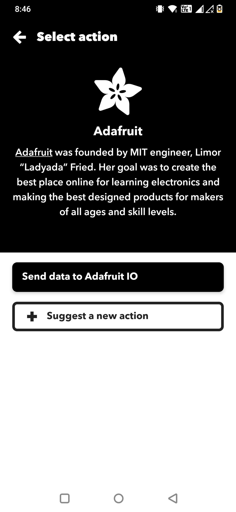

- Next, you'll see action configuration fields. In the action fields, select the feed we created earlier on Adafruit IO (**lock_state**). In the **"Data to save"** field, enter **lock** since this applet will send the lock command to your Smart Lock device.

    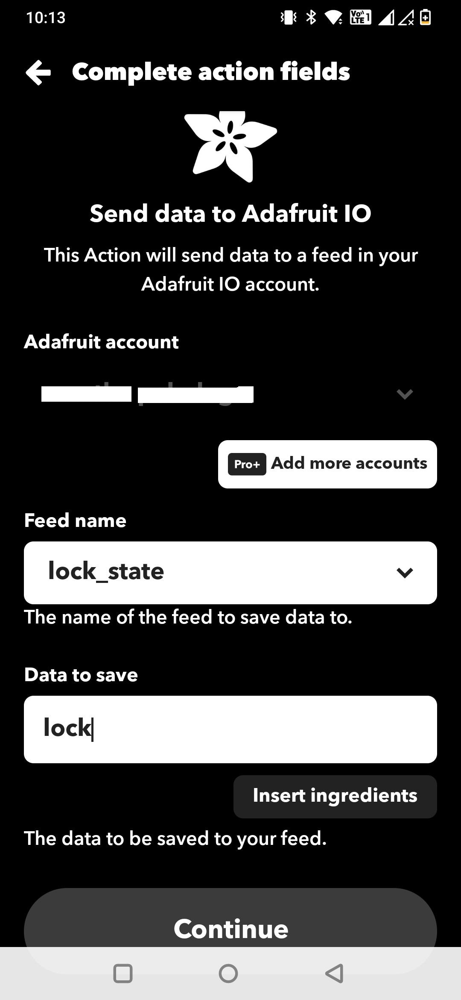

- Click **Continue** to review the applet and click the **Finish** button to complete. You may want to disable notifications when the applet runs to avoid getting notified every time you lock or unlock the door when using Google Assistant.

    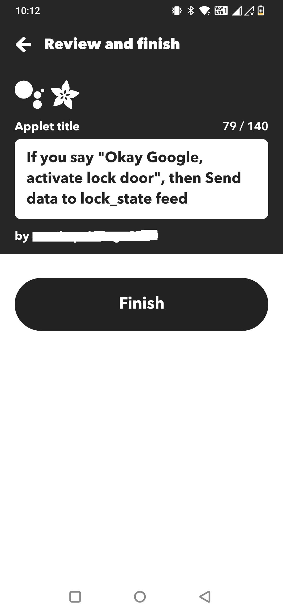

- If not previously installed, download and install **Google Assistant** app from play store.
Now after installing, Say, **OK Google** to trigger Google Assistant into listening mode and this specific phrase **OK Google Activate lock door** you set up from the previous step. 

- To control Smart Lock through **Google Home**, link IFTTT to **Google Home** by following this [link](https://help.ifttt.com/hc/en-us/articles/32838868423323-How-to-connect-IFTTT-to-Google-Home) to connect Google Home to IFTTT.

- You can now test your voice commands with Google Assistant. Say **"OK Google Activate lock door"** to send lock command to the device.

    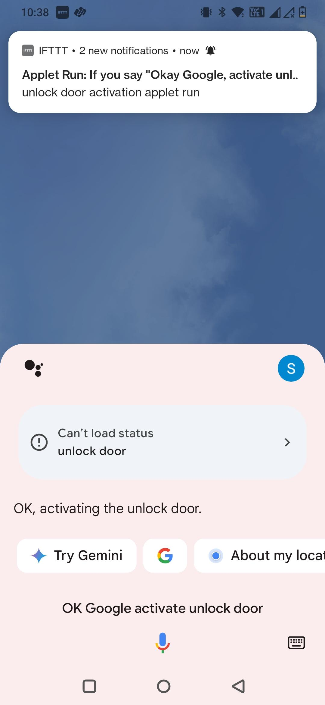

- This will then send data to **lock_state** feed and the same will be sent to our Smart Lock device. You can monitor this activity on your Adafruit.io dashboard by navigating to your **lock_state** feed, where you'll see a real-time graph showing the commands being sent. The feed will display timestamps and values ("lock"/"unlock") each time a voice command is executed.

    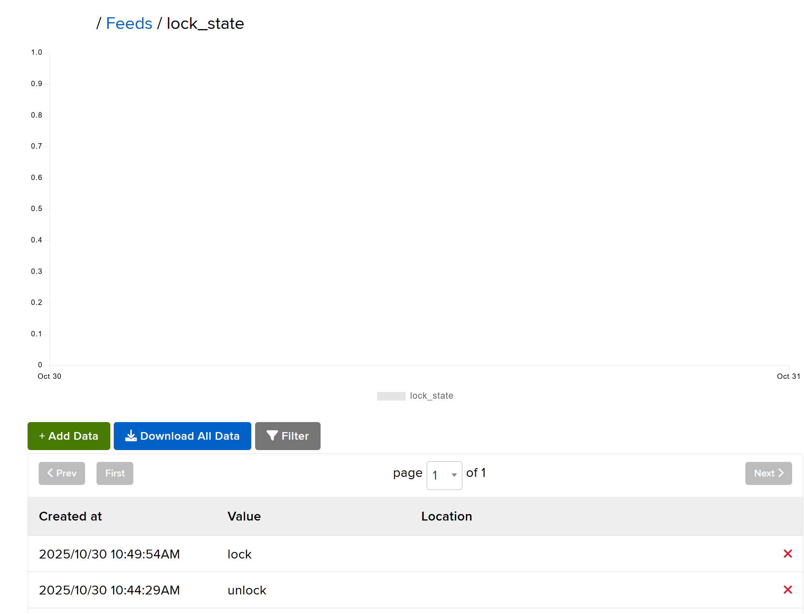

- Similarly, say this specific phrase **OK Google Activate lock door** to send lock command to the device.

Refer to [Smartlock_video](resources/Smart-Lock-video.mp4) demonstration where the Silicon Labs **Smart Lock** is operated using voice commands via Google Assistant.
